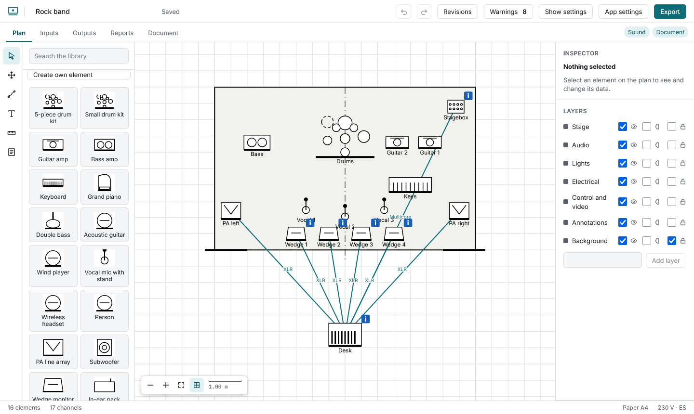
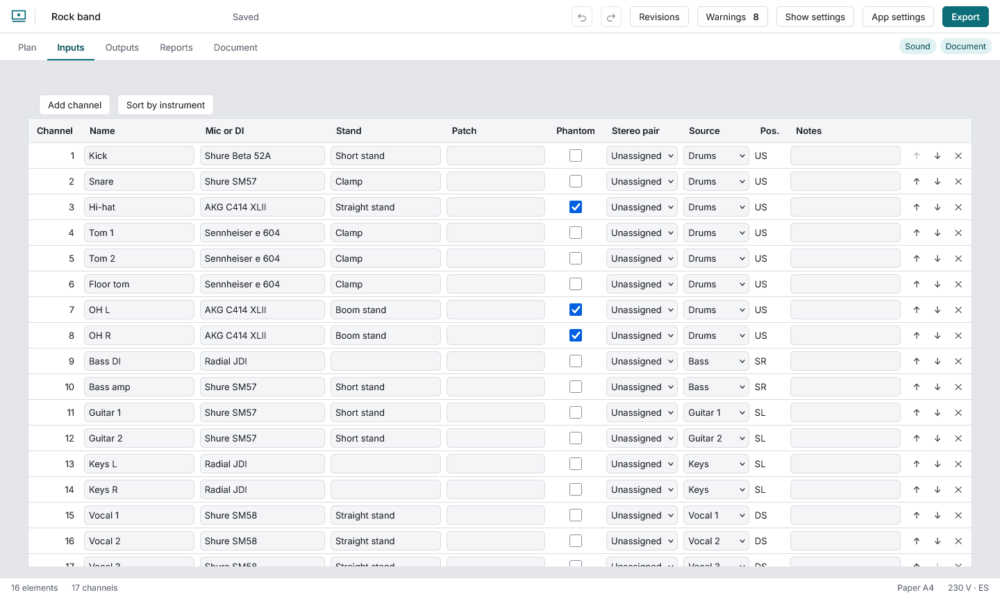
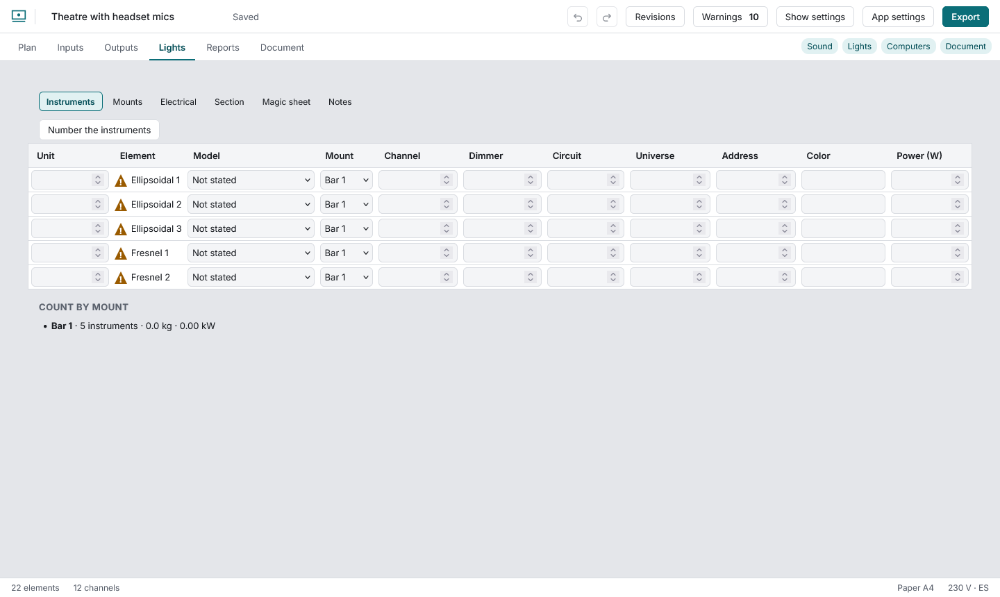
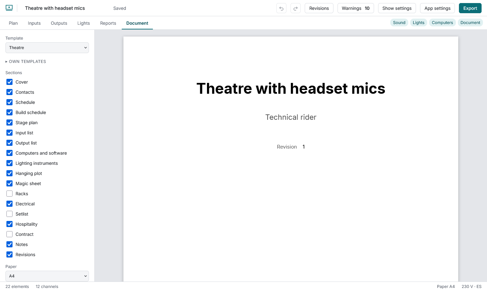
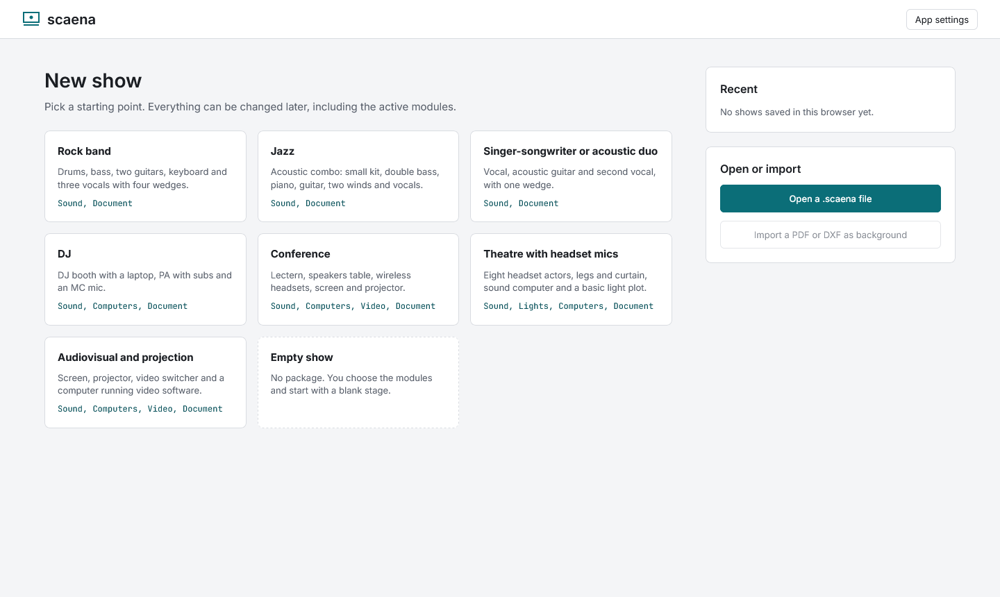

# scaena

Technical riders for live shows, in the browser: stage plot, input and output lists, light plot, one event's production sheets, reports and a PDF rider, all views of one model. Free, open source (GPL-3.0), no accounts and no servers: everything stays in your browser and in the files you save. Spanish and English. **Live: https://memoriainfinita.github.io/scaena/**



| | |
|---|---|
|  |  |
|  |  |

- **Plot:** a 2D plan with a library of 775 line-art symbols (one SVG per item, filtered by category), luminaires as icons or as RP-2 top-view outlines, your own items and layers, alignment, groups, measuring, permanent dimensions, a rectangular or free-form stage with reference lines, a PDF or DXF venue plan as a calibrated background, cables between elements with an estimated length, and export to DXF.
- **Sound:** input and output lists edited in place, the patch taken from the cables and their numbered ports, stereo pairs, phantom power from the microphone's type, signal flow.
- **Lights:** instruments with a model catalogue (weights and power from datasheets, estimates marked) plus 653 fixtures from the Open Fixture Library with their DMX modes, aim by dragging, mounts with height and load, DMX addressing by universe, circuits, dimmers and phases, side section, bar plan, magic sheet.
- **Computers, video and network:** a computer element with its programs (a catalogue of 62) and compatibility notes.
- **Production of one event:** setlist, day and build schedules, hospitality and contract, day sheet.
- **Rider PDF:** compiled in the browser with Typst, tagged, with the plot at a print scale. Plus CSV, SVG, PNG, revisions with comparison and an update sheet.
- **Warnings** (29 rules, each one can be muted) that never block exporting; works on a phone; installable; works offline.

[User guide](docs/guide/README.md) · [Guía en español](docs/guide/es/README.md) · [Documentation](docs/README.md) · [Changelog](CHANGELOG.md) · [Third-party notices](THIRD-PARTY-NOTICES.md)

## Develop

```bash
pnpm install
pnpm dev
```

| Command | Does |
|---|---|
| `pnpm test` | Unit tests (Vitest) |
| `pnpm lint` / `pnpm typecheck` | ESLint / TypeScript |
| `pnpm build` | Production build into `dist/` |
| `pnpm e2e` | Browser tests in Firefox (desktop, light theme, and a phone-sized window); needs `pnpm build` first |
| `pnpm e2e:chrome` | The same tests in the installed Chrome, as a second opinion |
| `node scripts/screenshots.mjs en\|es` | Regenerates the guide screenshots in English or Spanish |
| `node scripts/readme-shots.mjs` | Regenerates the English screenshots of this README |
| `node scripts/perf.mjs firefox 300 1000 3000` | Measures the plan with many elements (see `docs/research/rendimiento-app-2026-11-05.md`) |
| `node scripts/live-sweep.mjs` | Passes every package, view and language of the published site and reports console errors, failed requests and leaked text |
| `node scripts/live-check.mjs` | Opens the published site, makes a PDF and makes it again offline |
| `node scripts/licenses.mjs` | Regenerates `THIRD-PARTY-NOTICES.md` |
| `node scripts/make-icons.mjs` | Regenerates the app icons |

The code is organised by what it does: `src/model` (the data and its pure operations), `src/library` (symbols, catalogues, packages), `src/app` (state and actions), `src/ui` (the interface), `src/document` (the PDF), `src/reports`, `src/export`, `src/validate`, `src/background` (PDF and DXF import). Design decisions are written down before each part is built, in `docs/design/`; measurements in `docs/research/`.

## Publishing

The workflow in `.github/workflows/ci.yml` lints, tests, builds, runs the browser tests and checks the structure of a generated PDF; on a push to `main` it deploys `dist/` to GitHub Pages. See `docs/publishing.md`.
