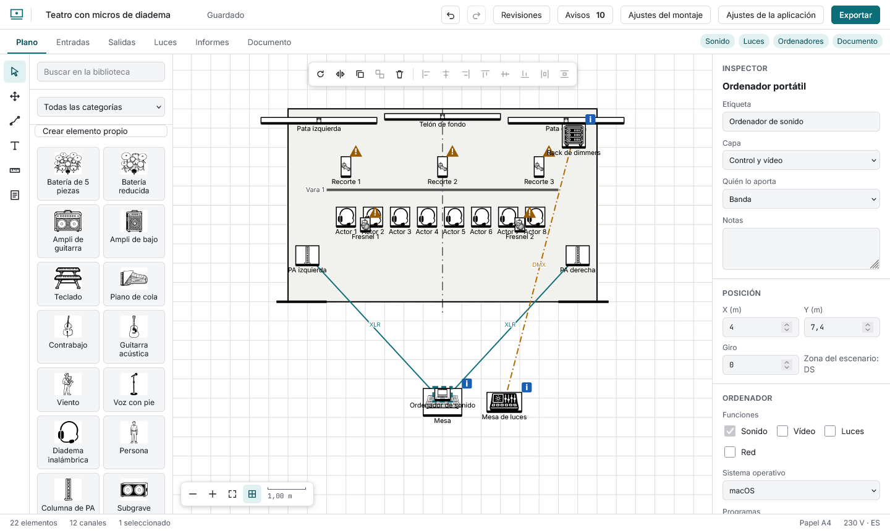

# Computers, video and network

A **laptop** from the library is an element with content. In the inspector: **functions** (sound, video, lights, network; at least one), **operating system**, **programs** (the field suggests a catalogue, QLab, Resolume, grandMA, Dante Controller…, and accepts anything; each has a “used for”), **license**, whether it needs a **physical key**, and its **outputs** (signal, connector, note). If a catalogue program does not exist for the system you chose, a note says so (“QLab only exists for macOS”).

With the **Cable or connection** tool, pick a signal type, then the source and the target. The plot draws a line labelled with the connector, with its own colour and stroke per signal; the inspector of either end lets you change the signal type, the connector (with suggestions for the signal), set the length or remove it. Leave the length empty and the field shows an estimate (for example "≈ 10"): the distance along the floor between both ends plus their height difference, ×1.1, plus 1.5 m of slack, rounded up to a stock length. Type the real length to replace it. Every cable is listed in the **Cables** report (Reports tab, CSV and a section of the PDF) with its ends, signal, connector and length.
