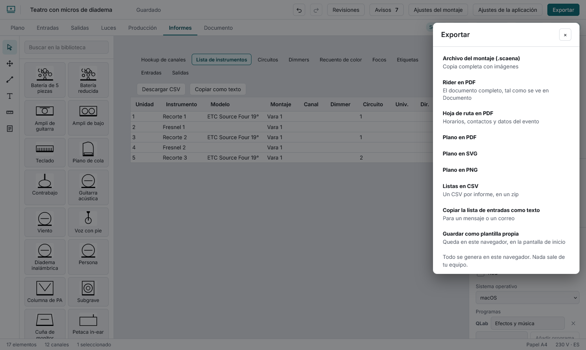
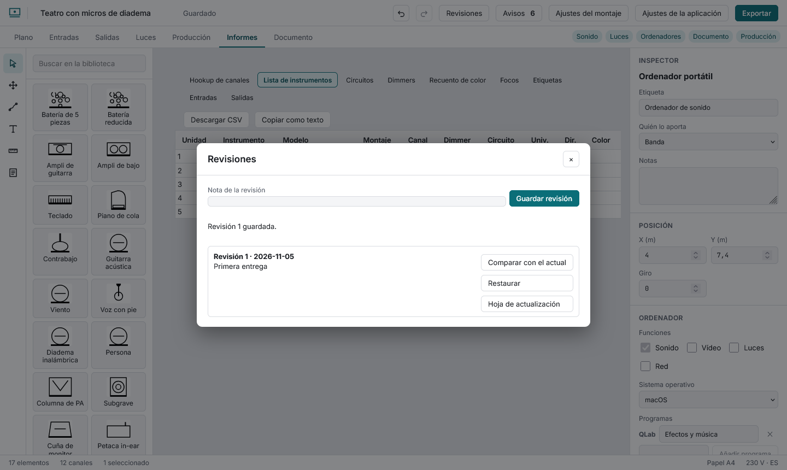

# Delivering and tracking changes

**Export** gives: the `.scaena` file (everything, with images), the rider PDF, the day sheet PDF, the plot as PDF, SVG (sized in paper millimetres) or PNG, a zip of CSV files (they open cleanly in Excel; cells that could run as formulas are defused), the input list copied as text, and **Save as my own template**.

A **revision** is a copy of the show at a moment, kept in this browser. **Save revision** bumps the number, records the date and your note, and works out what changed since the previous one. **Compare with current** shows what changed since a revision; **Compare two revisions** (from, to; "to" can be the current state) lists the changes between any two; **Restore** brings its content back as one undoable step (the list of revisions is kept); **Update sheet** makes a one-page PDF with the number, date, note and changes for whoever has the previous version. Browsers that keep no local data (private mode) cannot save revisions.
