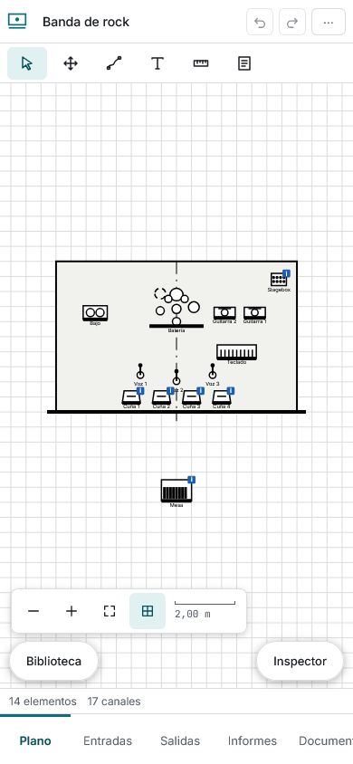
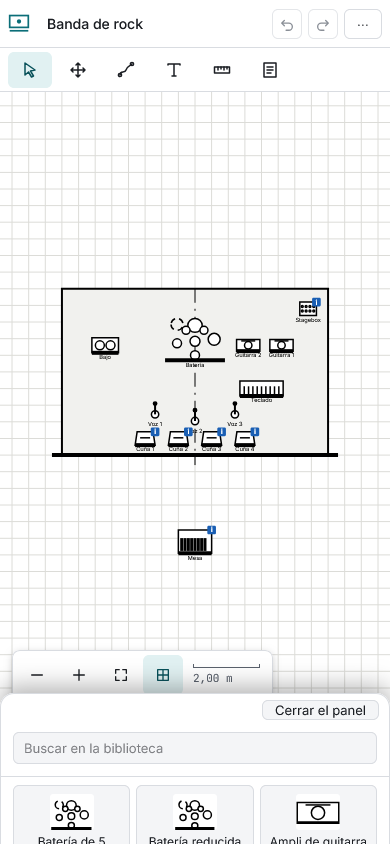

# Phone and offline

On a narrow screen the views sit in a bar at the bottom and the plot fills the screen. **One finger** on an element selects and drags it; on the background it pans (a tap that does not move lets go of the selection). **Two fingers** zoom and pan together. The library and inspector are sheets that rise from the bottom with the floating buttons; what does not fit the top bar (revisions, warnings, settings, export) is in the “⋯” menu.

**Install:** use your browser's **Install** or **Add to home screen**. **Offline:** after the first visit everything works without a network. Only the **first PDF** needs a connection once, to download the compiler. When a new version exists a notice offers **Update**; it never reloads while you work.
