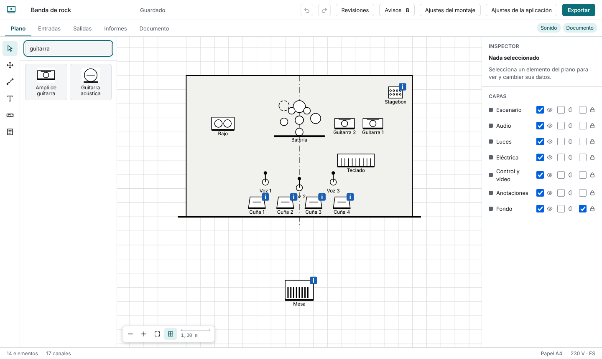
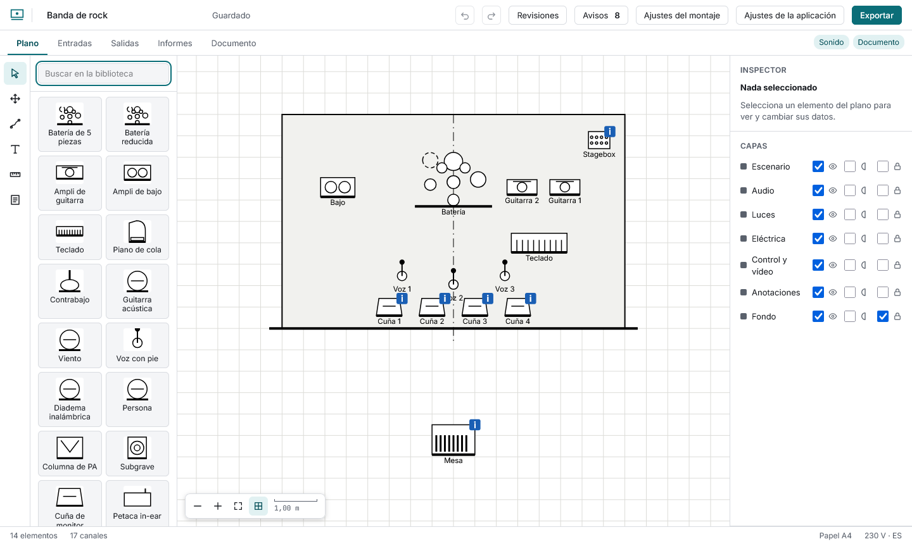
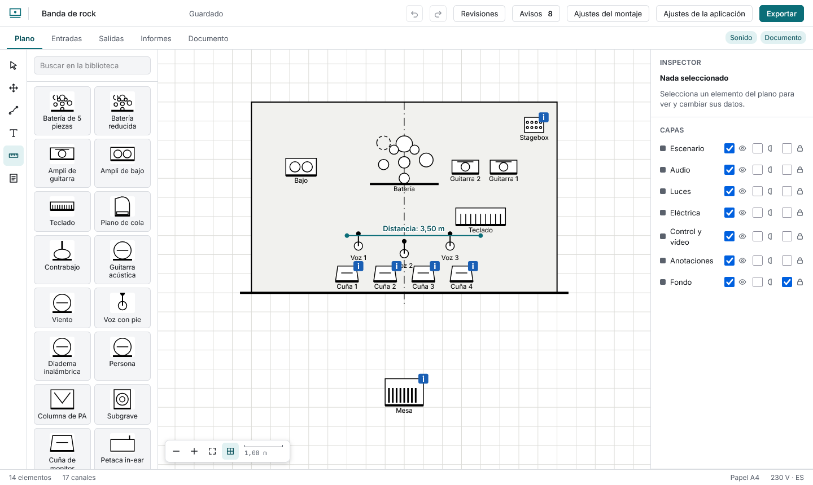
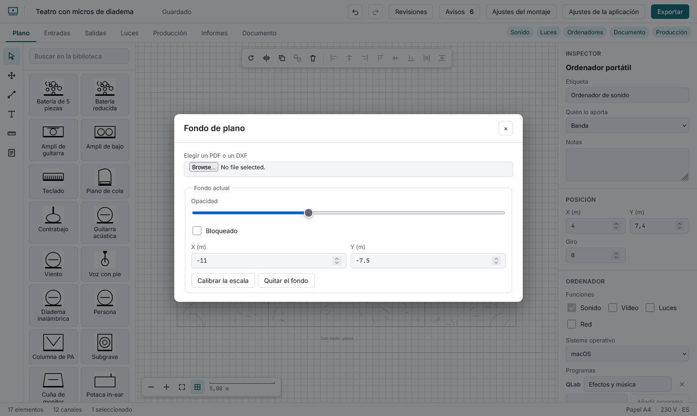

# The stage plot

Search the library (accents ignored) and click an element: it appears in the first free spot, selected. Drag it into place; it snaps to the grid (**Alt** while dragging turns snapping off). The inspector holds the label, who supplies it (band, venue, rental), notes, position and rotation.

**Shift**+click adds or removes; dragging on the background draws a selection box; **Ctrl+A** selects all. The bar on top rotates, flips, duplicates, groups, deletes, aligns (two or more) and distributes (three or more). A group moves as one. **Layers** can be hidden, dimmed and locked.

**Measure** gives the distance between two points (metres, or feet in imperial shows) and is not saved. **Text** drops a note and leaves its label ready to type.

**PDF or DXF background** imports the venue plan (up to 25 MB; a PDF becomes an image in your browser, a DXF is drawn as lines). **Calibrate the scale** by clicking two points a known distance apart and typing that distance; set the opacity and lock it. It is saved inside the show file.

Wheel to zoom, **Space** + drag or the Hand tool to pan, **0** to fit. On a phone: two fingers.
