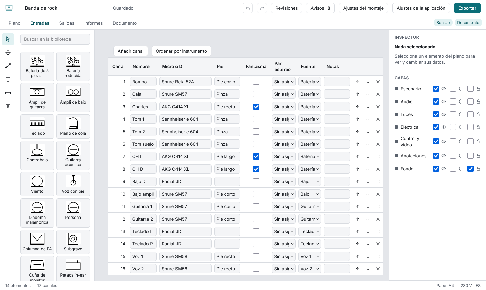
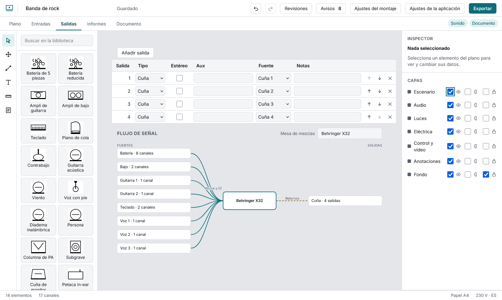

# Sound

Each row is a channel, edited in the table (each change is one undo step). Type a brand or model in **Mic or DI** and pick from the list, or type anything; picking a condenser ticks **48 V**, a dynamic clears it, and you can always override. Choose a **stereo pair** (the other channel is paired too; start pairs on an odd channel). **Source** is the plot element the channel comes from, and clicking a row selects it on the plot. Channels stay numbered 1 to n; up and down swap numbers, **Sort by instrument** groups them by kind.

Wedges, in-ears, main and sends, with their aux and the element that carries them. Below, the **signal flow**: sources grouped by element, the desk (type its model) and the outputs. Every line has a written label and its own stroke pattern, so colour is never the only cue.
