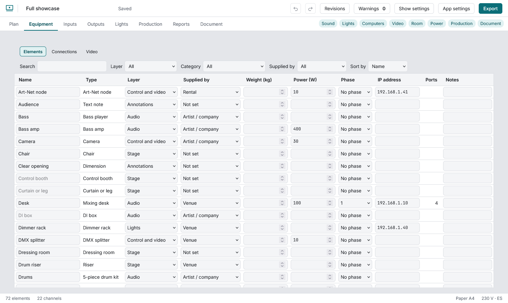

# Equipment

The **Equipment** view lists everything in the show as tables you edit in place; selecting a row selects the element on the plot, and the other way round. It has three sections.

- **Elements:** one row per element with its name, type, layer, who supplies it, power, weight, IP address and ports. Filter by text, layer, category and who supplies it, and sort by name, type, layer, supplier, power or weight. The table scrolls inside itself, so the page never overflows on a phone.
- **Connections:** every cable and link with its two ends, the ports it uses, the channels it carries (and whether they are stereo pairs), its length and its connector. Several cables between the same two elements are allowed and numbered; a tip warns when two of them are identical.
- **Video:** the video connections, with their **format** (a resolution as text, for example "1920x1080 50p"), and the video outputs that each computer declares. The PDF lists them in a **Video** section when the show has video cables.

Nothing here is a separate copy: it is the same data the plot, the inspector and the PDF read.
