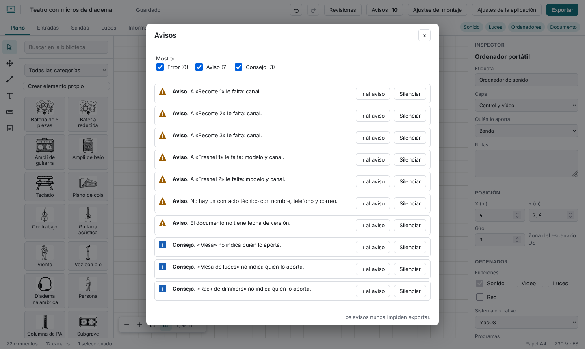

# Los avisos

El botón **Avisos** de la barra superior muestra cuántos hay. Cada uno dice con palabras qué pasa y tiene un botón **Ir al aviso** que abre el sitio donde se arregla. **Los avisos nunca impiden exportar**: son ayuda, no un freno.

Hay tres gravedades, con su forma además de su color (círculo, triángulo y cuadrado):

- **Error:** el documento saldría incorrecto. Una fila que apunta a algo que ya no existe, dos instrumentos con la misma dirección DMX, dos elementos con la misma IP, un dimmer o una fase por encima de su máximo, una vara que carga más de lo indicado.
- **Aviso:** probablemente falla algo. Canales sin nombre o sin micro, un par estéreo que empieza en canal par, una cuña pedida y no dibujada, un instrumento al que le faltan datos, una toma de corriente sin marcar, unidades repetidas, una hora mal escrita, un programa que no existe en el sistema del ordenador, el mismo patch en dos canales, un cable que el elemento no puede llevar (un cable de vídeo en una batería), un cable más largo de lo habitual para su conector, sin contacto o sin fecha.
- **Consejo:** mejora posible. Huecos en la numeración, monitores desordenados, elementos sin «quién lo aporta».

Los avisos también aparecen como una marca pequeña en la fila de la tabla y como una insignia sobre el elemento del plano. Pasa el ratón por la marca para leer el motivo. En el panel puedes filtrar por gravedad.

**Silenciar** esconde un aviso con el que has decidido convivir: sale de la cuenta, de las marcas y de la lista. **Mostrar silenciados** los devuelve (marcados «Silenciado») y **Reactivar** restaura uno. Cada acción se deshace.
