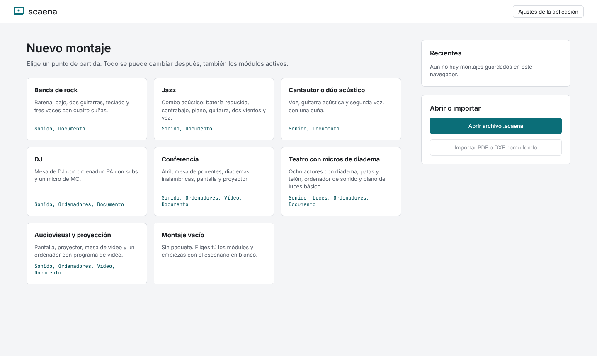
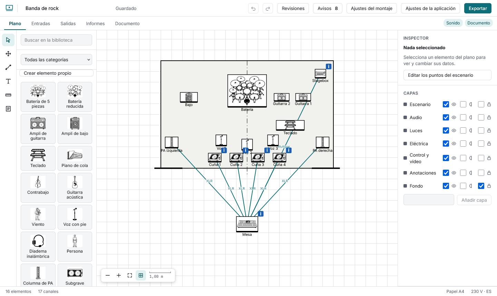

# Empezar

## Un montaje nuevo

En la pantalla de inicio elige el que más se parezca a lo tuyo: banda de rock, jazz, cantautor, DJ, conferencia, teatro con micros de diadema o audiovisual. Cada uno viene con el plano colocado, la lista de canales con micros sugeridos y, en el caso del teatro, un plano de luces básico. Todo se puede cambiar. Si prefieres empezar de cero, **Montaje vacío**.

- A la izquierda, la **biblioteca** de elementos (instrumentos, amplis, monitores, mesas, ordenadores, luces…). Pulsa uno para ponerlo en el plano.
- En el centro, el **plano**. Arriba, las **vistas**: Plano, Entradas, Salidas, Luces, Producción, Informes y Documento. Solo salen las que tus módulos necesitan.
- A la derecha, el **inspector** (los datos del elemento elegido) y las **capas**.

## Los módulos

En **Ajustes del montaje** activas lo que necesitas: Sonido, Luces, Ordenadores, Vídeo, Sala, Eléctrica, Documento y Producción. También eliges el tamaño del escenario, la región eléctrica (con su tensión y enchufe habituales), el papel (A4, A3, Letter o Tabloid) y el idioma del documento, que puede ser distinto del de la interfaz.

## Abrir lo que ya tienes

- **Recientes:** todos tus montajes guardados en este navegador. Cada uno se puede duplicar o eliminar (eliminar pide confirmar).
- **Abrir un archivo .scaena:** el archivo del montaje completo, con sus imágenes.
- **Mis plantillas:** desde **Exportar → Guardar como plantilla propia** guardas una copia sin revisiones; aparece aquí para empezar montajes nuevos con ella.

La aplicación guarda sola mientras trabajas. Detalles en [Tus datos](datos.md).
