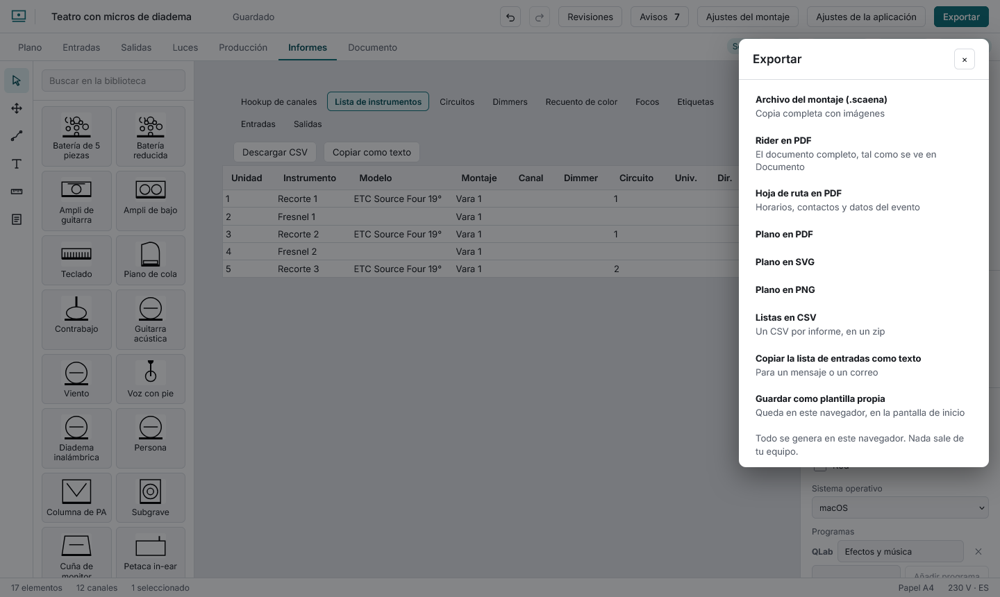
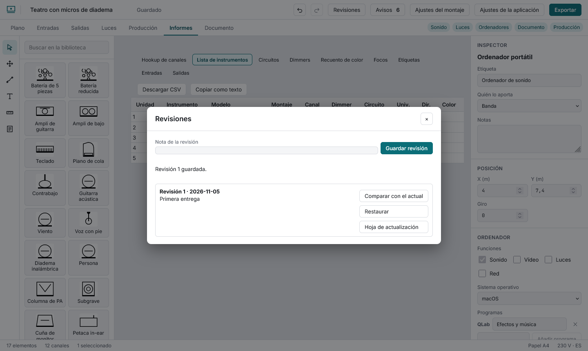

# Entregar y llevar el control de cambios

## Exportar

| Opción | Qué da |
|---|---|
| Archivo del montaje (.scaena) | Una copia completa, con imágenes, para guardarla o pasársela a otra persona que use scaena |
| Rider en PDF | El documento completo de la vista Documento |
| Hoja de ruta en PDF | Horarios, contactos y datos del evento |
| Plano en PDF | Solo el plano, a la escala elegida |
| Plano en SVG | El plano en vectores, medido en milímetros de papel |
| Plano en DXF | Para programas de CAD: milímetros, una capa DXF por capa del plano, símbolos como líneas y círculos y etiquetas de texto |
| Plano en PNG | El plano como imagen de 3000 píxeles de ancho |
| Listas en CSV | Un CSV por informe, en un zip |
| Copiar la lista de entradas como texto | Para un mensaje o un correo |
| Guardar como plantilla propia | Una copia en este navegador para empezar otros montajes |

Los CSV se abren bien en Excel (llevan marca de codificación) y cualquier celda que empiece por `=`, `+`, `-` o `@` va con una comilla delante para que la hoja de cálculo no la ejecute como fórmula.

## Revisiones

Una **revisión** es una copia del montaje en un momento dado, guardada en este navegador. **Guardar revisión** sube el número, anota la fecha y tu nota, y calcula qué cambió desde la anterior (elementos añadidos, quitados o movidos, canales, salidas, montajes…).

- **Comparar con el actual** muestra qué ha cambiado desde esa revisión.
- **Comparar dos revisiones** (desde, hasta; «hasta» admite el estado actual) muestra los cambios de una a otra, en el orden elegido.
- **Restaurar** devuelve su contenido como un paso que se puede deshacer; la lista de revisiones se conserva.
- **Hoja de actualización** es un PDF de una página con el número, la fecha, la nota y los cambios, para quien ya tiene la versión anterior.

Si tu navegador no guarda datos locales (modo privado), no puede guardar revisiones y el diálogo lo dice.
