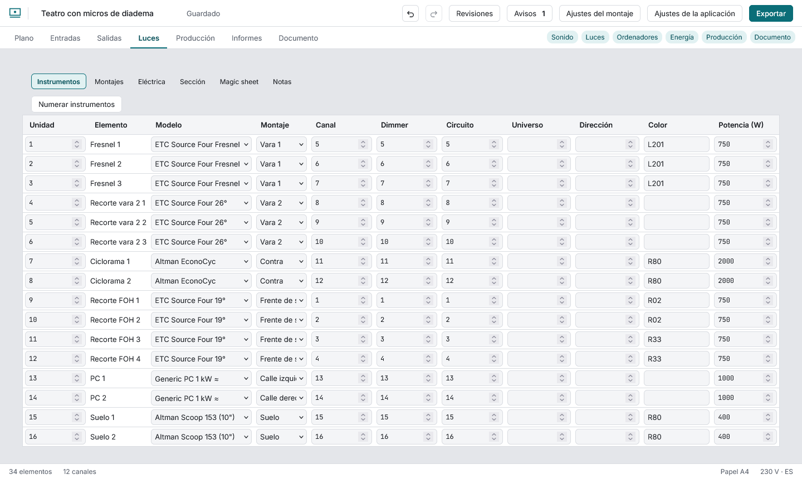
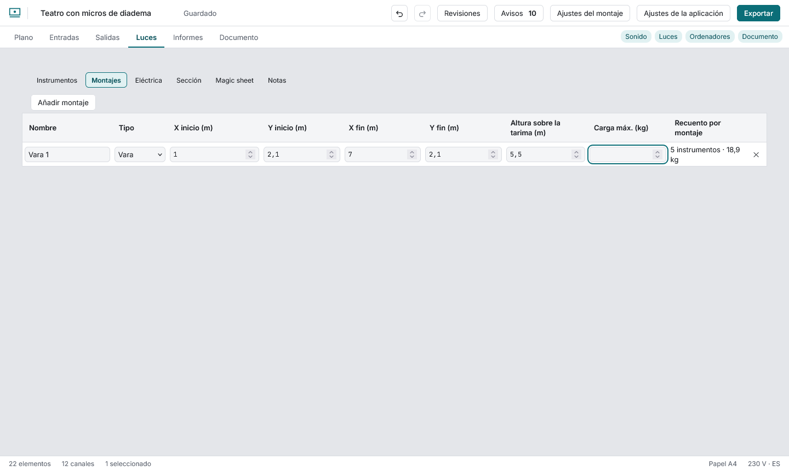
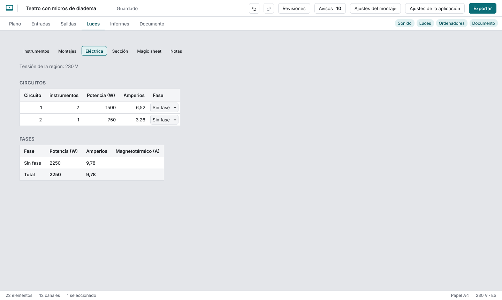
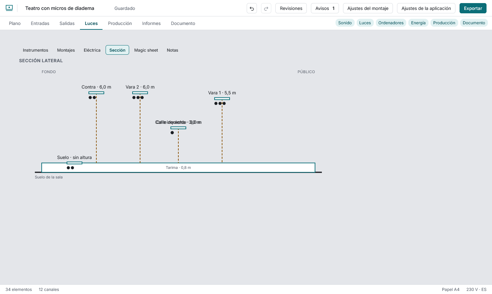

# Luces

Activa el módulo **Luces** en Ajustes del montaje (el paquete de teatro ya lo trae). Aparece la vista Luces con seis secciones (Instrumentos, Montajes, Eléctrica, Sección, Magic sheet y Notas).

## Instrumentos

Cada luminaria es una fila: unidad, modelo, montaje, canal, dimmer, circuito, universo, dirección, color y potencia. Al elegir un **modelo** del catálogo se copian su peso y su potencia (los modelos genéricos llevan «≈»: son estimaciones, no datos de ficha). La lista de modelos del inspector ofrece además unos 650 equipos de la Open Fixture Library agrupados por fabricante (sobre todo LED y móviles); su peso y su potencia los aportan voluntarios, y el panel lo dice y enlaza a la ficha del equipo. **Numerar instrumentos** da unidades de 1 a n por montaje y de izquierda a derecha. Debajo ves el **recuento por montaje**: cuántos hay, su peso y su potencia, y un aviso si pasan de la carga máxima.

## Montajes

Varas, tubos, truss, calles laterales y suelo. Cada uno tiene nombre, extremos, **altura** y **carga máxima**. Se dibujan en el plano como una línea con su nombre. Quitar un montaje deja sus instrumentos en el plano, sin montaje.

## Eléctrica

Potencia y amperios por circuito a la tensión de la región, el máximo de cada dimmer y el total por fase (L1, L2, L3). Indica el magnetotérmico de cada fase para que la aplicación avise si se supera.

El equipo que no es luz también cuenta. Amplis, altavoces, mesas, proyectores, portátiles, máquinas de haze y similares traen una potencia típica (una estimación, no el dato de la ficha) y la sección **Consumo** del inspector te deja cambiarla y elegir la fase (L1 a L3) a la que está enchufado. Sin fase se cuenta en «Sin fase». El informe **Consumo** (pestaña Informes, CSV y una tabla en la sección Eléctrica del PDF) lista cada equipo con sus vatios y amperios, las luces y el total. Las listas de Entradas e Instrumentos muestran además el cable que sale de cada fuente (conector, longitud, destino) en la columna **Conexiones**; el PDF mantiene su propio diseño.

## Sección

Una vista lateral del escenario: de fondo a público en horizontal y la altura en vertical. Cada montaje está a su altura con sus instrumentos. Un montaje sin altura se dibuja en el suelo y se dice. La sección dibuja la tarima del escenario (su altura se fija en **Ajustes del montaje → Escenario**) y cada tarima o plataforma del plano con su propia altura; la altura de un montaje se mide desde la tarima. Selecciona una tarima o plataforma para poner su **altura sobre la tarima** en el inspector.

Si das al proscenio una **altura de la boca** (Ajustes del montaje → Escenario), la boca se dibuja en el borde del público con su altura; desactiva la línea de referencia del proscenio para ocultarla.

## Magic sheet

Cada instrumento es un círculo con su canal (y su color) donde cuelga, para que quien lleva la mesa encuentre un canal por su sitio. Parte de las posiciones del plano, pero tiene su propia disposición: arrastra un instrumento, o enfócalo y usa las flechas (100 mm; **Mayús** 500 mm; **Alt** 20 mm) para ponerlo donde lo quiera el operador. Moverlos aquí nunca los mueve en el plano. Con la hoja ya ordenada dejan de dibujarse las posiciones de colgado; **Restablecer disposición** vuelve a las posiciones del plano. El PDF usa la misma disposición.

## Notas

Notas de trabajo (una tarea, con enlace opcional al instrumento seleccionado) que se marcan como hechas y se quitan; también son un informe.

## Punto de mira

En el plano, selecciona un foco y pulsa **Fijar punto de mira**: aparece un tirador donde apunta y el plano dibuja el haz como una cuña. Arrastra el tirador o muévelo con las flechas; **Quitar punto de mira** lo borra. El informe de focos lee de ahí.

## Informes de luces

En **Informes** tienes el hookup de canales, la lista de instrumentos, circuitos, dimmers, recuento de color, focos, etiquetas imprimibles, recuento de equipo, hoja resumen de canales, plan de varas y notas de trabajo. El **plan de varas** lista los instrumentos de cada montaje en orden de colgado (de izquierda a derecha desde el público; una torre lateral, a lo largo de su eje) con el peso y la potencia del montaje. Ver [El PDF del rider](pdf.md) y [Entregar](entregar.md).
