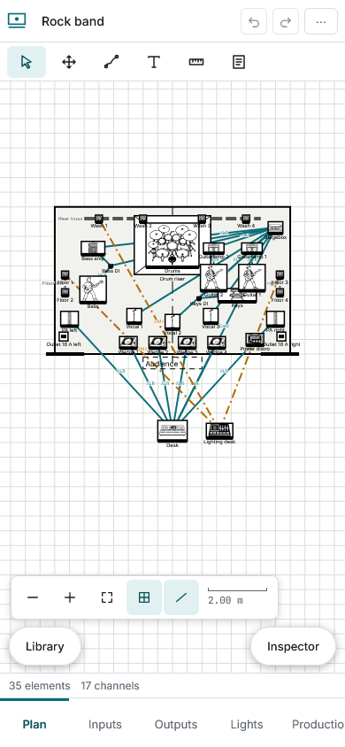
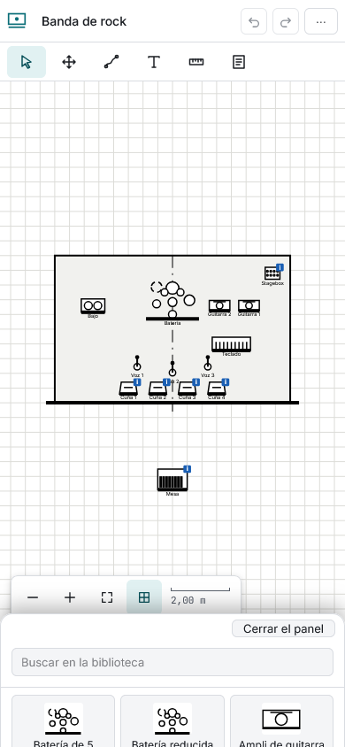

# Móvil y sin conexión

En una pantalla estrecha el editor se reorganiza:

- Las **vistas** están en una barra abajo.
- El **plano** ocupa toda la pantalla. **Un dedo** sobre un elemento lo selecciona y lo arrastra; sobre el fondo, desplaza la vista (un toque sin mover suelta la selección). **Dos dedos** hacen zoom y desplazamiento a la vez.
- La **biblioteca** y el **inspector** son hojas que suben desde abajo con los botones flotantes. «Cerrar el panel» las baja.
- Lo que no cabe en la barra superior (revisiones, avisos, ajustes y exportar) está en el menú «⋯».

## Instalarlo

En un navegador compatible, el menú del navegador ofrece **Instalar** o **Añadir a la pantalla de inicio**. Se abre en su propia ventana, como una aplicación.

## Sin conexión

Tras la primera visita, scaena abre y funciona sin red: planos, listas, informes y fondos. Solo el **primer PDF** necesita conexión una vez, para bajar el compilador; después también se genera sin red. Cuando hay una versión nueva sale un aviso con un botón **Actualizar**: nunca se recarga sola mientras trabajas.
