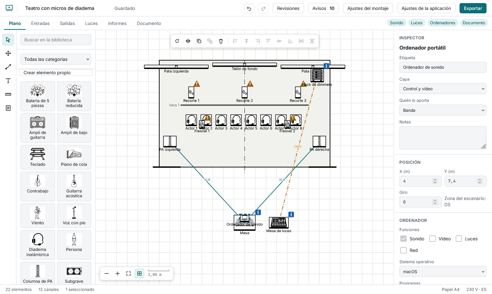

# Ordenadores, vídeo y red

Un **ordenador portátil** de la biblioteca es un elemento con contenido. En el inspector indicas:

- **Funciones:** sonido, vídeo, luces, red (siempre al menos una).
- **Sistema operativo** y **programas**. El campo sugiere el catálogo (QLab, Resolume, grandMA, Dante Controller…) y acepta cualquier otro. Cada programa lleva su «para qué». Si indicas un sistema en el que un programa del catálogo no existe, sale una nota: «QLab solo existe para macOS».
- **Licencia** y si necesita una **llave física**.
- **Salidas:** qué señal saca, por qué conector (HDMI, DisplayPort, USB audio, Dante, DMX, MIDI) y una nota.

Un ordenador aparece siempre en el PDF, aunque no tengas el módulo de Ordenadores.

## Conectar elementos

Con la herramienta **Cable o conexión** eliges el tipo de señal (audio, vídeo, control de luces o red), pulsas el elemento de origen y luego el de destino. En el plano se dibuja una línea con el nombre del conector (cada señal tiene su color y su trazo). En el inspector de cualquiera de los dos extremos puedes cambiar el tipo de señal, el conector (con sugerencias según la señal), indicar la longitud o quitar la conexión. Si dejas la longitud vacía, el campo muestra una estimación (por ejemplo «≈ 10»): la distancia por el suelo entre los dos extremos más la diferencia de altura, ×1,1, más 1,5 m de holgura, redondeada a una medida comercial. Escribe la real para sustituirla. Todos los cables salen en el informe **Cables** (pestaña Informes, CSV y una sección del PDF) con sus extremos, señal, conector y longitud.

## Puertos y varios cables

En el inspector de cualquier equipo, **Puertos** lista lo que admite y lo que saca: un nombre, una dirección (entrada, salida o ambas), un formato y un número de canales. **Rellenar desde la biblioteca** añade los puertos habituales de ese tipo de equipo (mesas, stageboxes, interfaces y previos de audio, red, proyectores, pantallas, cámaras y capturadoras); son valores típicos del tipo, no una ficha técnica, y la nota lo dice. Se rellenan solos al colocar una mesa o una stagebox. Un cable puede entonces nombrar el puerto de cada extremo, cuántos **canales** lleva y si son pares **estéreo**; **USB** es un tipo de señal propio. Los avisos comprueban que un puerto no se use dos veces, que la dirección y la señal coincidan y que los canales quepan.

Puedes dibujar varios cables entre los mismos dos elementos (por ejemplo HDMI y un DisplayPort de respaldo): el plano los dibuja en paralelo y el inspector los numera.
