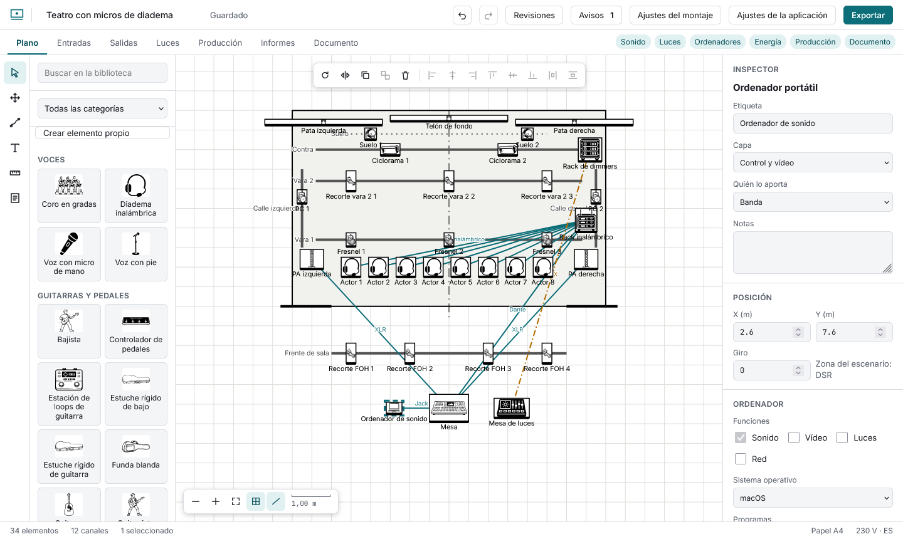

# Ordenadores, vídeo y red

Un **ordenador portátil** de la biblioteca es un elemento con contenido. En el inspector indicas:

- **Funciones:** sonido, vídeo, luces, red (siempre al menos una).
- **Sistema operativo** y **programas**. El campo sugiere el catálogo (QLab, Resolume, grandMA, Dante Controller…) y acepta cualquier otro. Cada programa lleva su «para qué». Si indicas un sistema en el que un programa del catálogo no existe, sale una nota: «QLab solo existe para macOS».
- **Licencia** y si necesita una **llave física**.
- **Salidas:** qué señal saca, por qué conector (HDMI, DisplayPort, USB audio, Dante, DMX, MIDI) y una nota.

Un ordenador aparece siempre en el PDF, aunque no tengas el módulo de Ordenadores.

## Conectar elementos

Con la herramienta **Cable o conexión** eliges el tipo de señal (audio, vídeo, control de luces o red), pulsas el elemento de origen y luego el de destino. En el plano se dibuja una línea con el nombre del conector (cada señal tiene su color y su trazo). En el inspector de cualquiera de los dos extremos puedes cambiar el tipo de señal, el conector (con sugerencias según la señal), indicar la longitud o quitar la conexión. Todos los cables salen en el informe **Cables** (pestaña Informes, CSV y una sección del PDF) con sus extremos, señal, conector y longitud.
