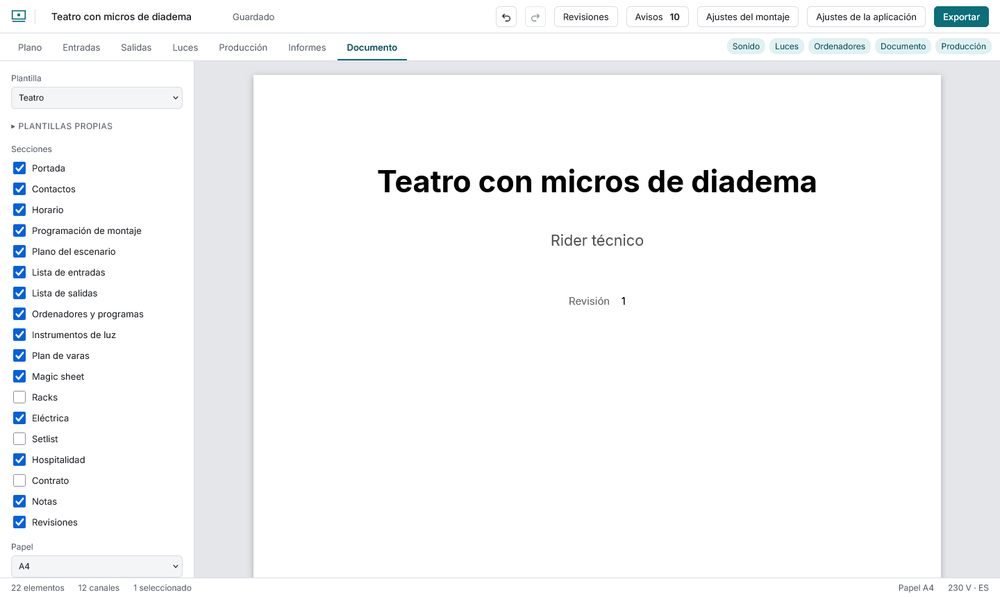
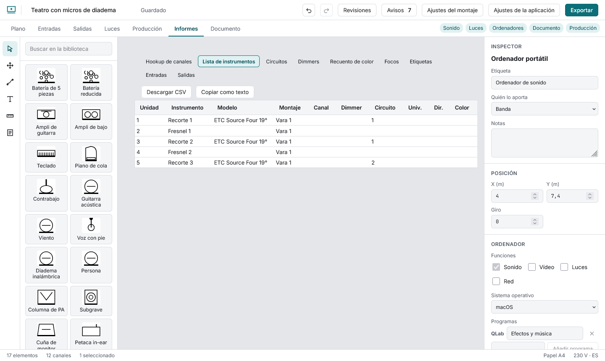

# El PDF del rider

En la vista **Documento** ves el PDF tal como saldrá y se actualiza solo un momento después de cada cambio. La **primera vez** descarga el compilador de PDF (unos 11 MB); queda guardado para las siguientes y funciona sin conexión.

## Qué lleva

- **Plantilla:** concierto, teatro, audiovisual o personalizada. Cada una activa un conjunto de secciones; marcar o desmarcar una pasa a «Personalizada» con lo que había.
- **Secciones:** portada, contactos, horario, programación de montaje, plano, entradas, salidas, ordenadores, luces, eléctrica, setlist, hospitalidad, contrato, notas y revisiones. Las que no tienen datos no se imprimen. Los ordenadores y las secciones de luces entran solos si hacen falta.
- **Datos del documento:** producción, sala, autoría, fecha y revisión, y los contactos. Cada contacto tiene casillas para **no imprimir el teléfono** o **el correo**.
- **Papel:** A4, A3, Letter o Tabloid.
- **Escala del plano:** «ajustar a la página» o 1:25, 1:50, 1:100, 1:200. El plano lleva leyenda y barra de escala. Si no cabe a la escala pedida se reduce y el panel lo dice.
- **Vista en escala de grises:** para comprobar cómo saldrá en una fotocopia en blanco y negro.

El panel avisa de las palabras demasiado largas para su columna (por ejemplo, una dirección web sin espacios).

## Descargar

**Descargar PDF**. Es un PDF etiquetado (los lectores de pantalla lo recorren), con las fuentes incrustadas, el título y el idioma puestos.

## Informes

La vista **Informes** muestra cada lista como tabla: hookup de canales, instrumentos, circuitos, dimmers, recuento de color, focos, etiquetas, entradas y salidas. Cada una se descarga en CSV o se copia como texto para pegarla donde quieras.
