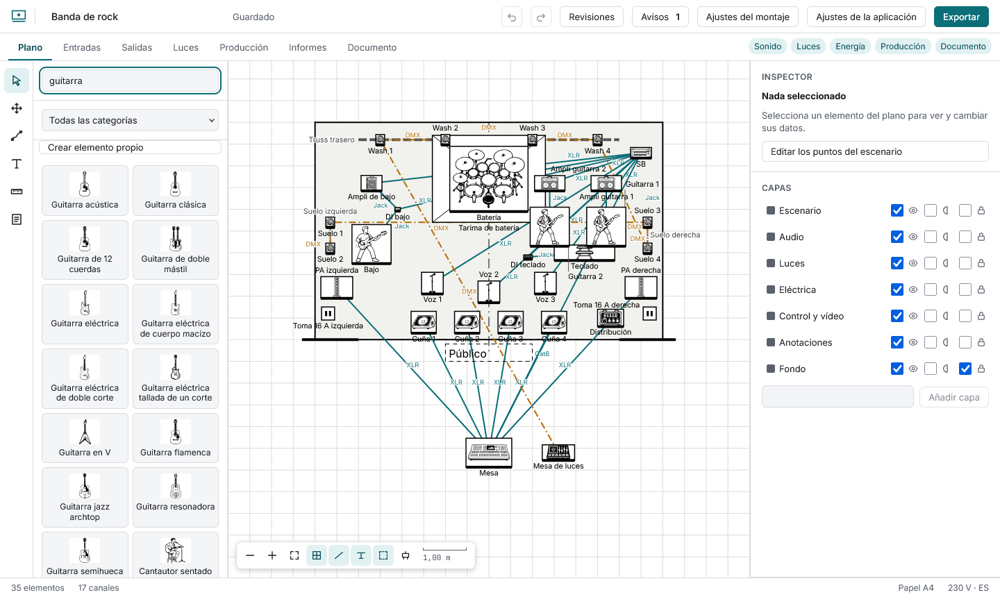
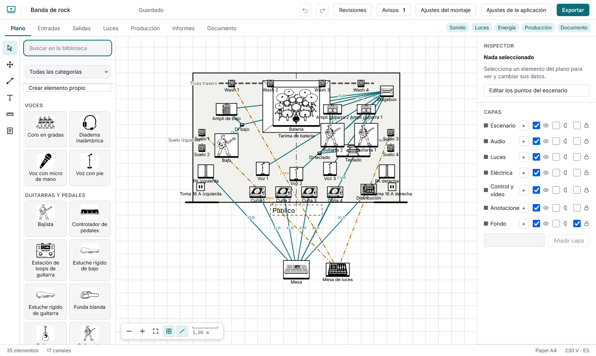
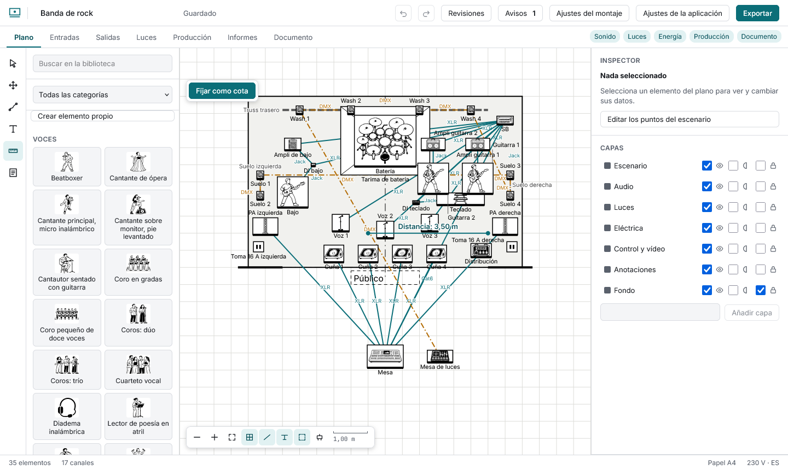
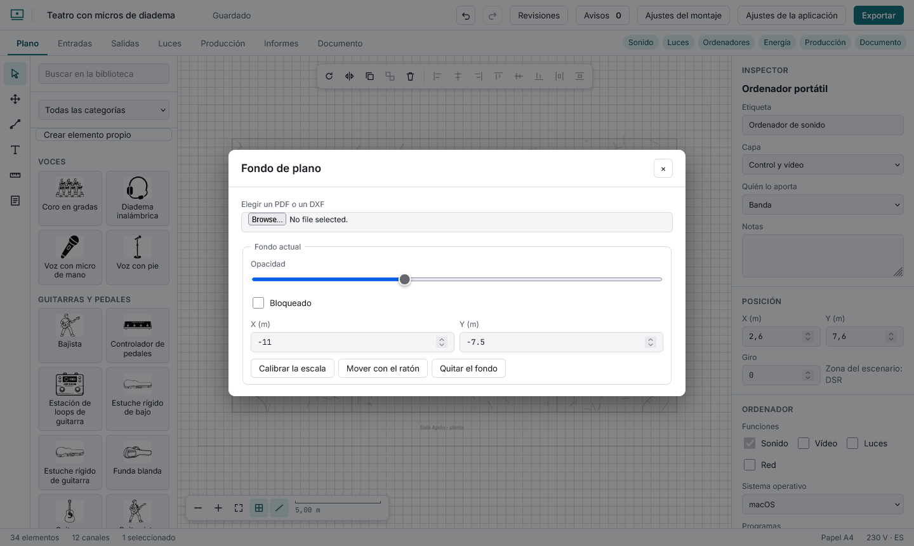

# El plano del escenario

## Poner elementos

La biblioteca tiene unos 780 elementos dibujados como iconos de línea. Sin búsqueda sale ordenada por categorías (tus elementos primero), cada una con su título y por nombre dentro; al buscar (sin importar los acentos) salen antes los nombres que empiezan por lo escrito. Acota con el menú **Categoría** sobre la lista y pulsa el elemento: aparece en el primer hueco libre del escenario, seleccionado. Arrástralo para colocarlo; se ajusta a la cuadrícula (**Alt** al arrastrar la desactiva). En el plano el icono y el contorno fino que hay debajo, la huella real con su línea frontal, giran juntos con el elemento (las luces giran con su punto de mira); las etiquetas siguen rectas. Con mucho alejamiento solo se ve la huella gris. Los instrumentos de zurdo se dibujan reflejando el elemento. El botón **Líneas de conexión**, abajo junto a la cuadrícula, muestra u oculta los cables entre elementos; también vale para el plano del PDF y las exportaciones. A su lado, **Nombres de los elementos** oculta el texto escrito bajo los elementos y **Bordes de los elementos** oculta el contorno fino que los iconos dibujan alrededor de su huella, para aligerar un plano cargado; los dos valen también para el PDF y las exportaciones. **Luces con símbolos RP-2** dibuja las luminarias con el contorno en vista cenital que espera un iluminador en un plano de luces, en lugar del icono (el ejemplo de teatro empieza con él puesto); las luces sin ese contorno conservan su icono. Vale también para el PDF, y el DXF usa siempre los contornos. En la pestaña **Documento**, la *Leyenda de símbolos bajo el plano* también es opcional: si la apagas, el plano recupera ese espacio. **Cambiar por otro del mismo tipo**, en el inspector, cambia un micro, ampli, proyector o cualquier elemento por otro de su categoría sin rehacer nada: se mantienen la etiqueta, la posición, los canales, los cables, los datos de luz, el ordenador y las notas. La biblioteca y el inspector se ensanchan o estrechan arrastrando su borde interior (o con el foco en él y las flechas); el ancho se recuerda. En el inspector puedes escribir la etiqueta, quién lo aporta (banda, sala, alquiler), notas, posición y giro.

## Seleccionar y editar varios a la vez

- Pulsa un elemento; **Mayús** + pulsar añade o quita. Arrastra sobre el fondo para un **recuadro de selección**; **Ctrl+A** selecciona todo.
- La barra de arriba gira, voltea, duplica, agrupa, borra y alinea o distribuye lo seleccionado (alinear pide dos elementos, distribuir tres).
- Un grupo se mueve y se selecciona como uno. **Ctrl+G** agrupa y **Ctrl+Mayús+G** desagrupa.
- Las **capas** (a la derecha) se pueden mostrar, atenuar y bloquear. Un elemento en una capa bloqueada no se puede tocar.

## Medir y escribir en el plano

La herramienta **Medir** da la distancia entre dos puntos (en metros, o en pies si el montaje es imperial). Tras medir, **Fijar como cota** la deja en el plano como una cota en la capa Anotaciones: lee su longitud, se mueve como cualquier elemento, sale en el PDF y se deshace. La herramienta **Texto** coloca una nota y deja la etiqueta lista para escribir.

## Un plano de la sala de fondo

Con la herramienta **Fondo PDF o DXF** importas el plano de la sala. El PDF se convierte en imagen en tu navegador y el DXF se dibuja en líneas; hasta 25 MB. Luego:

1. **Calibrar la escala:** pulsa dos puntos del plano que estén a una distancia conocida y escribe esa distancia. El fondo se reescala alrededor del primer punto.
2. **Mover con el ratón:** arrastra el fondo por el plano y pulsa **Terminar**. Es un solo paso de deshacer y no funciona mientras el fondo esté bloqueado (también puedes escribir su posición X e Y).
3. Ajusta la **opacidad** y, si quieres, **bloquéalo**.

El fondo se guarda dentro del archivo del montaje.

## El escenario

En **Ajustes del montaje → Escenario**: ancho y fondo, un **ancho de proscenio** opcional (vacío, sin proscenio; la línea se dibuja como dos paredes con la boca en medio) y las **líneas de referencia** que se muestran (eje central, línea de proscenio, boca del proscenio). La **altura de la tarima** es la del escenario sobre el suelo de la sala (cuenta en la sección lateral). Las zonas elevadas dentro del escenario son elementos **Tarima** y **Plataforma** de la biblioteca, cada uno con su altura en el inspector. Para un escenario de forma irregular, marca **Escenario de forma libre** y escribe los puntos, uno por línea como `x; y` en metros (al menos tres). Si dos lados se cruzan, un aviso los nombra. Las líneas de referencia y el proscenio también valen para un escenario de forma libre: la línea de proscenio va por su lado más bajo, el eje central por la mitad de su ancho y las paredes del proscenio alrededor de esa mitad. Para darle forma sobre el plano, sin nada seleccionado, pulsa **Editar los puntos del escenario** en el inspector (un rectángulo se convierte antes en un escenario libre con sus cuatro esquinas): arrastra un punto, o enfócalo con Tab y muévelo con las flechas (Mayús, diez pasos); **Supr** lo quita (tres es el mínimo) y el **+** pequeño de un lado añade un punto en su mitad. **Escape** termina. La **altura de la boca** (también en Ajustes del montaje → Escenario) se dibuja en la sección lateral.

## Mover la vista

Rueda del ratón para acercar, **Espacio** + arrastrar (o la herramienta Mano) para desplazar, **0** para encajar el plano. En el móvil: dos dedos. Ver [Atajos](atajos.md).

## Tamaño de los símbolos

Cada símbolo se dibuja al tamaño real aproximado de la pieza, en milímetros y a la misma escala que el escenario (un sub de 600 × 700 mm mide 0,6 × 0,7 m en un escenario medido en metros). Son tamaños típicos, no los de un modelo concreto. En el inspector, **Ancho** y **Fondo** (en metros) cambian el tamaño del elemento seleccionado y **Tamaño de la biblioteca** lo devuelve a su medida; el símbolo se estira para ajustarse, así que un rack que aporta la sala puede dibujarse con su medida exacta.

## Capas propias

Bajo la lista de capas, escribe un nombre y pulsa **Añadir capa** para crear una capa tuya (hasta 20). Pulsa una capa (su cuadrado, o su asa si es tuya) para resaltarla: los elementos nuevos de la biblioteca irán a ella; púlsala otra vez para volver a la capa propia de cada uno; para mover elementos que ya están en el plano, selecciónalos y cambia **Capa** en el inspector. Se puede renombrar, reordenar arrastrando su asa (o con las flechas arriba y abajo cuando tiene el foco; la que está más abajo en la lista se dibuja encima) y quitar; al quitarla, sus elementos vuelven a la capa de su tipo. Para pasar un elemento a una capa, elígela en el campo **Capa** del inspector.

## Elementos propios

**Crear elemento propio** (arriba de la biblioteca) toma un dibujo SVG de hasta 200 KB y pide nombre, tamaño real, altura, peso, potencia y capa. El dibujo se reconstruye solo con formas, trazados, grupos y colores lisos: el texto, las imágenes, los degradados, los enlaces, los estilos y los scripts se omiten (el diálogo dice cuántas partes), y los trazos se redibujan a 1,5 px. El elemento vive en el montaje y viaja en el archivo `.scaena`; sale el primero en las búsquedas de la biblioteca y solo se puede borrar cuando ya no está en el plano.
