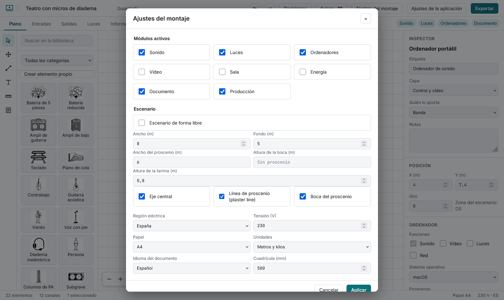
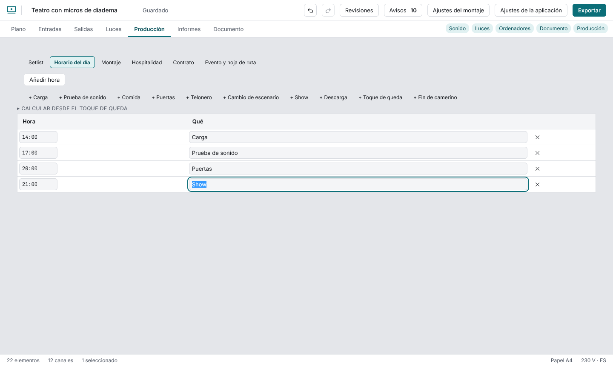
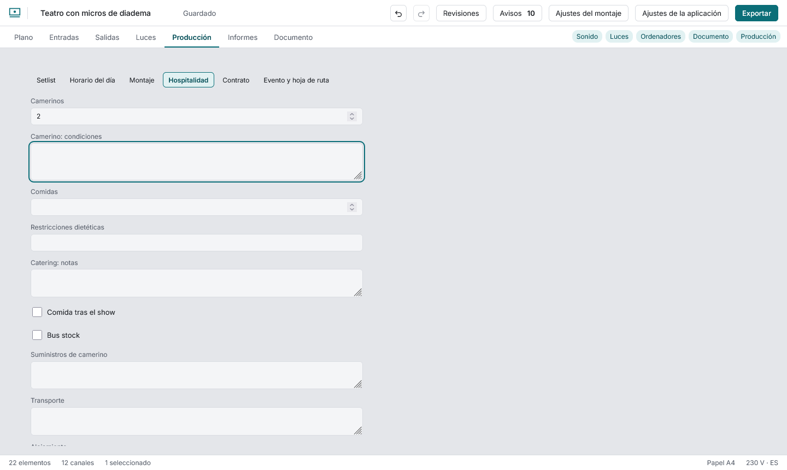

# Producción de un evento

Activa el módulo **Producción** en Ajustes del montaje.

Es para **un solo evento**. Si das varios conciertos, duplica el montaje desde la pantalla de inicio y cambia la fecha: cada uno tiene su propio rider.

## Horario del día y del montaje

**Calcular desde el toque de queda** (desplegable sobre la lista) trabaja el día hacia atrás: la descarga acaba en el toque de queda, el show acaba cuando empieza la descarga, las puertas abren antes del show, la prueba de sonido acaba cuando abren las puertas y la carga acaba cuando empieza la prueba. Pones las duraciones (por defecto: show 90 min o lo que sume el setlist, descarga 60, cambio de escenario 0, puertas 30 antes, prueba 60, carga 120) y un **margen extra** (50 % por defecto) que se suma a la carga y a la descarga. Ves las horas antes de **Aplicarlas**: una fila que ya se llame igual (Carga, Puertas…) cambia de hora y las demás se añaden, todo en un paso de deshacer. Si la carga caería antes de medianoche, no se calcula.

Los botones **+ Carga, + Prueba de sonido, + Puertas…** añaden la fila con su nombre; tú pones la hora (`8:30` o `20:30`). Las filas se leen siempre por hora, y una hora con otro formato se marca y entra en los avisos. La pestaña **Montaje** es lo mismo para las llamadas de carga, focus y pruebas.

## Setlist

Título, comentario y duración (`4:30`, `4,5` minutos o `270 s`) con el total debajo. Se reordena con subir y bajar.

## Hospitalidad y contrato

Formularios con lo habitual de un rider: camerinos y sus condiciones, comidas y dietas, comida tras el show, bus stock, suministros, transporte, alojamiento y compensación en efectivo; y en el contrato, caché, anticipo, pago, cancelación, seguros, duración del show y personal. scaena solo lo guarda y lo imprime: no da consejo legal.

## Evento y hoja de ruta

Dirección de la sala, aparcamiento y notas, y el botón **Descargar la hoja de ruta (PDF)**: una hoja con el horario del día, el de montaje, los contactos (sin lo que hayas ocultado) y los datos del evento.
