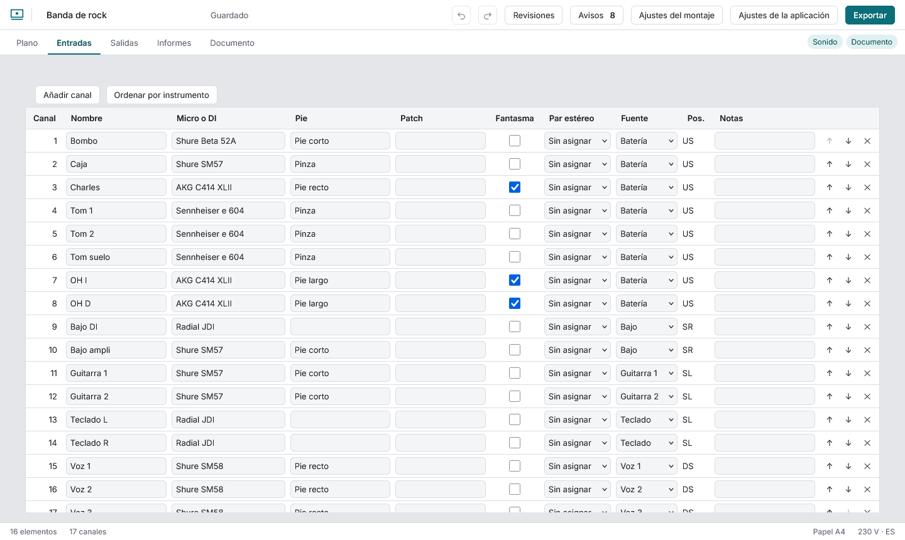
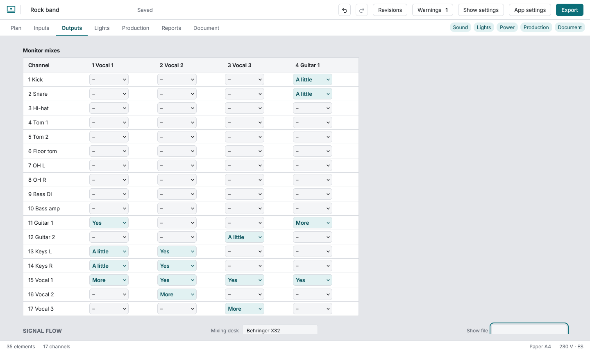

# Sonido: entradas y salidas

## La lista de entradas

Cada fila es un canal. Se edita en la propia tabla; cada cambio se confirma al salir de la celda y se puede deshacer.

- **Micro o DI:** empieza a escribir una marca o un modelo y elige de la lista, o escribe lo que quieras. Al elegir un micro de condensador se marca solo el **48 V** (fantasma); uno dinámico lo quita. Siempre puedes corregirlo.
- **Par estéreo:** elige el canal pareja; el otro queda emparejado a la vez. Empieza el par en un canal impar.
- **Fuente:** el elemento del plano de donde sale. Al pulsar una fila se selecciona ese elemento en el plano.
- Los canales se numeran de 1 a n sin huecos; **subir** y **bajar** intercambian números y **Ordenar por instrumento** agrupa por tipo (batería, guitarras, teclas, voces…).

## Las salidas y el flujo de señal

Cuñas, in-ear, principal y envíos, con su aux y el elemento que las lleva. Debajo, el **flujo de señal**: las fuentes agrupadas por elemento, la mesa (escribe su modelo) y las salidas. Cada línea lleva su nombre escrito y un trazo distinto: el color nunca va solo.

## Patch y posición

**Patch** es dónde se conecta el canal (stagebox y puerto, por ejemplo «SB A 12»); el mismo patch en dos canales avisa. **Pos.** muestra dónde está la fuente en el escenario (US fondo, DS proscenio, C centro, SL izquierda del artista, SR derecha del artista, y combinaciones como USC o DSL), leída del plano; el PDF añade una leyenda bajo la tabla. En Salidas, **Numerar cuñas** renumera las cuñas dibujadas de izquierda a derecha y de delante atrás con los números que ya tienen; las demás salidas conservan los suyos.

## Racks

Añade un **Rack** desde la biblioteca y pulsa **Montar el rack** en su panel: fija sus unidades (U), añade equipos con su altura y súbelos o bájalos. Avisa cuando sobran equipos y el rack aparece en los informes y como sección del documento.

## Cosas que avisan

Canales sin nombre o sin micro, pares mal empezados, cuñas dibujadas que nadie pide (o al revés), monitores desordenados. Ver [Los avisos](avisos.md).
