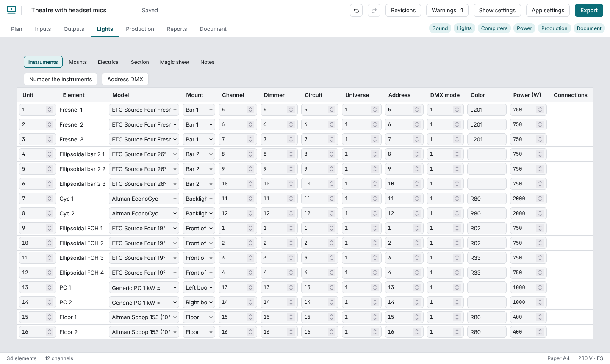
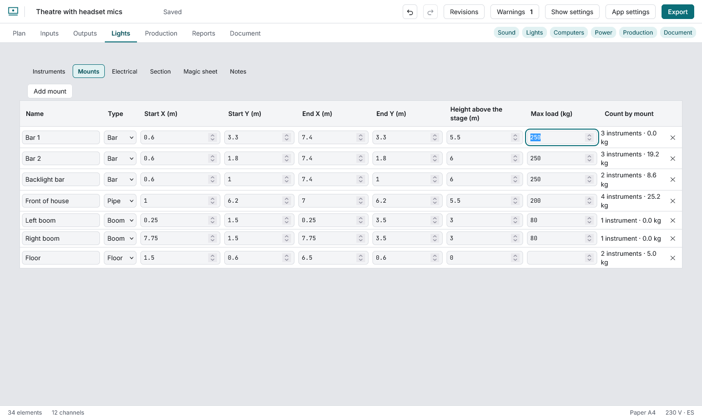
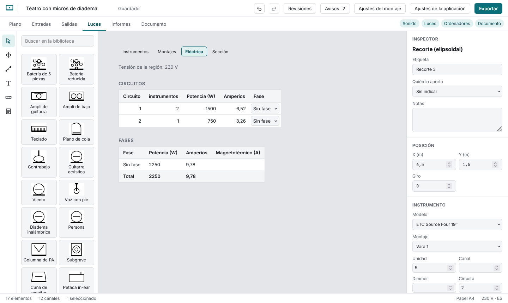
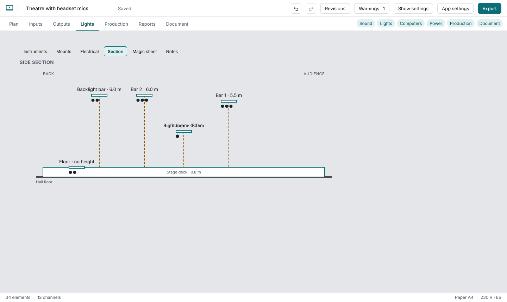

# Lights

Turn on the **Lights** module (the theatre package already has it). Six sections (Instruments, Mounts, Electrical, Section, Magic sheet and Notes):

**Instruments:** unit, model, mount, channel, dimmer, circuit, universe, address, colour and power. Picking a **model** copies its weight and power (generic models carry “≈”: they are estimates, not datasheet values). The inspector's model list also offers about 650 fixtures from the Open Fixture Library grouped by maker (mostly LED and moving lights); their weight and power are contributed by volunteers, so the panel says so and links to the fixture's page. **Number the instruments** gives units 1 to n by mount and left to right. Below, the **count by mount** with weight and power, and a warning when a bar is over its maximum load.

**Mounts:** bars, pipes, truss, booms and floor, each with name, ends, **height** and **maximum load**; drawn on the plot as a line with its name.

**Electrical:** power and amps per circuit at the region's voltage, each dimmer's maximum and the total per phase (L1 to L3). Enter each phase's breaker to be warned when it is exceeded.

Equipment that is not a light counts too. Amplifiers, speakers, desks, projectors, laptops, haze machines and similar items come with a typical power draw (an estimate, not a datasheet value), and the inspector's **Power draw** section lets you change it and choose the phase (L1 to L3) it is plugged into. Without a phase it is counted under "No phase". The **Power** report (Reports tab, CSV, and a table in the Electrical section of the PDF) lists every piece with its watts and amps, the lights, and the total. The Inputs and Instruments lists also show the cable that leaves each source (connector, length, destination) in a **Connections** column; the PDF keeps its own layout.

**Section:** a side view, back to audience across and height up. It draws the stage deck (its height is set in **Show settings → Stage**) and every riser and platform on the plot with its own height; a mount's height is measured from the deck. Select a riser or platform to set its **height above the deck** in the inspector. If you give the proscenium an **opening height** (Show settings → Stage), the opening is drawn at the downstage edge with its height; turn the proscenium reference line off to hide it.

**Magic sheet:** every instrument as a circle with its channel (and colour) where it hangs, for the board operator to find a channel by position. It starts from the plan positions, but it has its own arrangement: drag an instrument, or focus it and use the arrow keys (100 mm; **Shift** 500 mm; **Alt** 20 mm) to put it where the operator wants it. Moving instruments here never moves them on the plan. Once the sheet is arranged the hanging positions are no longer drawn; **Reset arrangement** goes back to the plan positions. The PDF uses the same arrangement.

**Notes:** work notes (a task, optionally tied to the selected instrument) that can be ticked off and removed; they are also a report.

**Focus point:** on the plot, select a light and press **Set focus point**: a handle appears where it points and the plan draws the beam as a wedge. Drag the handle, or move it with the arrow keys; **Clear focus point** removes it. The focus chart reads from it.

The lighting reports (hookup, instrument schedule, circuits, dimmers, colour count, focus chart, labels, equipment count, channel cheat sheet, hanging plot and work notes) are in **Reports**. The **hanging plot** lists each mount's instruments in hanging order (left to right from the audience; a side tower along its own axis) with the weight and power of the mount.
