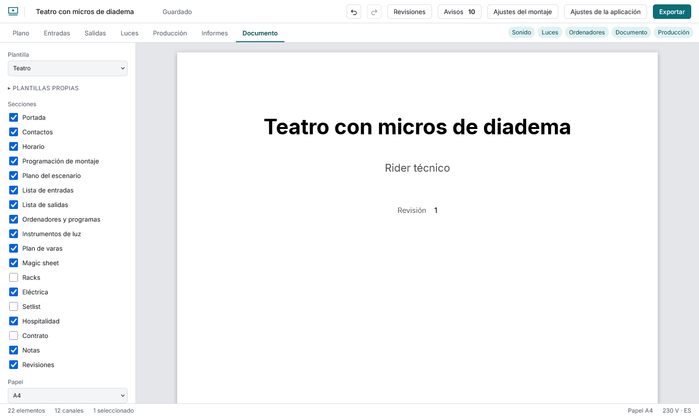
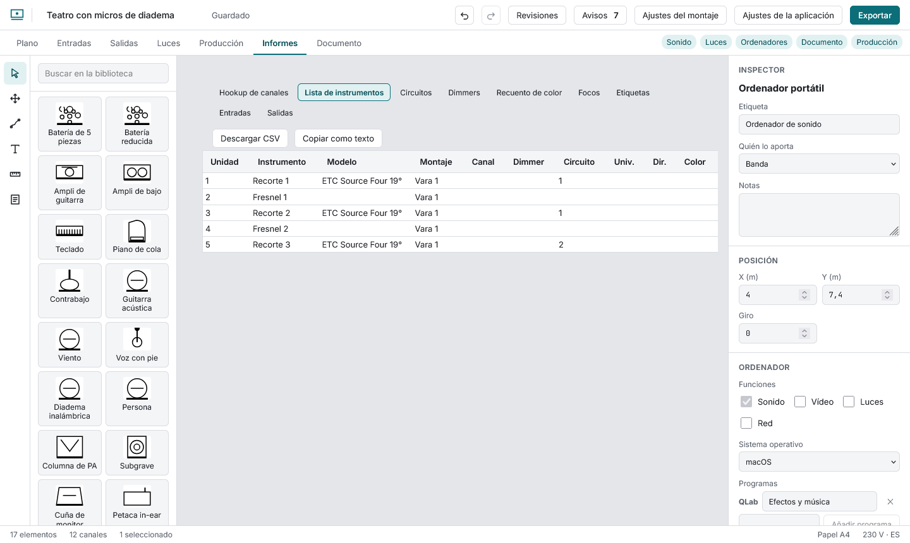

# The rider PDF

The **Document** view shows the PDF as it will come out and refreshes a moment after each change. **The first time** it downloads the PDF compiler (about 11 MB); it is kept for next time and works offline.

Choose a **template** (concert, theatre, audiovisual, custom) or tick sections yourself (cover, contacts, schedule, build schedule, plot, inputs, outputs, computers, lights, electrical, setlist, hospitality, contract, notes, revisions). Sections with no data are not printed. Fill in the **document details** (production, venue, author, date, revision, contacts; each contact can hide its phone or email). Pick the **paper** and the plot's **scale** (fit, or 1:25 to 1:200, with a legend and scale bar). With the inputs section on, choose the channel list's orientation (portrait or landscape) and its **blocks** (1 to 4, or automatic): with several, the rows are split into consecutive blocks side by side in a compact table (channel, name, mic or DI, patch, 48 V); automatic uses the fewest blocks that fit one page. In the document details you can add a **logo** (PNG, JPEG or SVG, up to 2 MB) that prints above the title on the cover. **Own templates** keeps the paper, sections, plot scale and channel-list layout under a name (up to 30, in this browser; the same name replaces one); applying it makes the document custom and skips sections whose module is off. **Greyscale view** previews a black-and-white photocopy. The panel warns about words too long for their column.

**Download PDF** gives a tagged PDF (screen readers can read it) with fonts embedded and title and language set.

**Reports** shows each list as a table (channel hookup, instruments, circuits, dimmers, colour count, focus, labels, inputs, outputs) with CSV download and copy-as-text.
