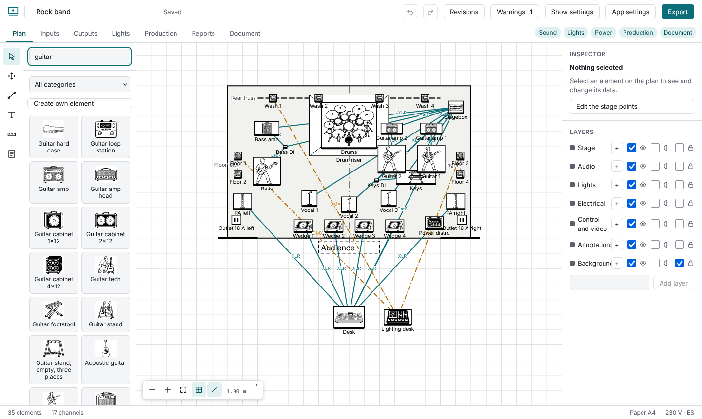
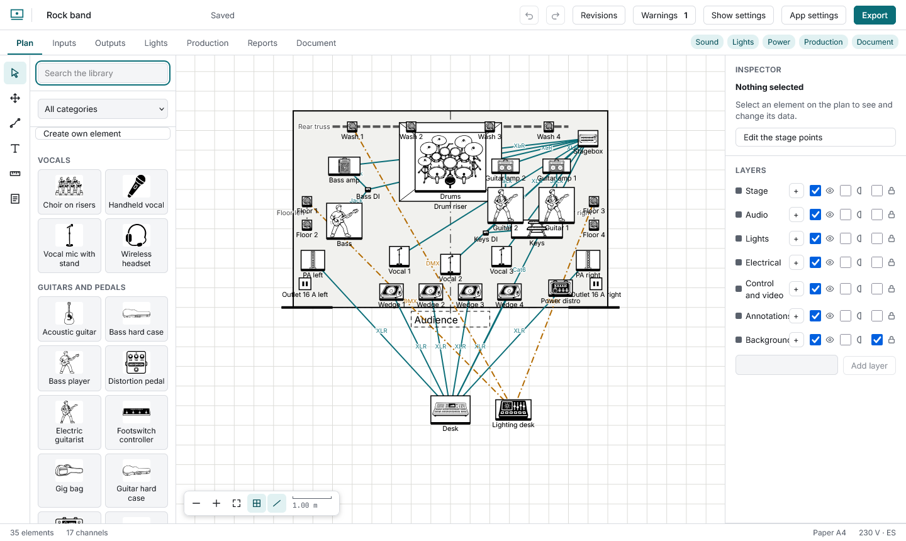
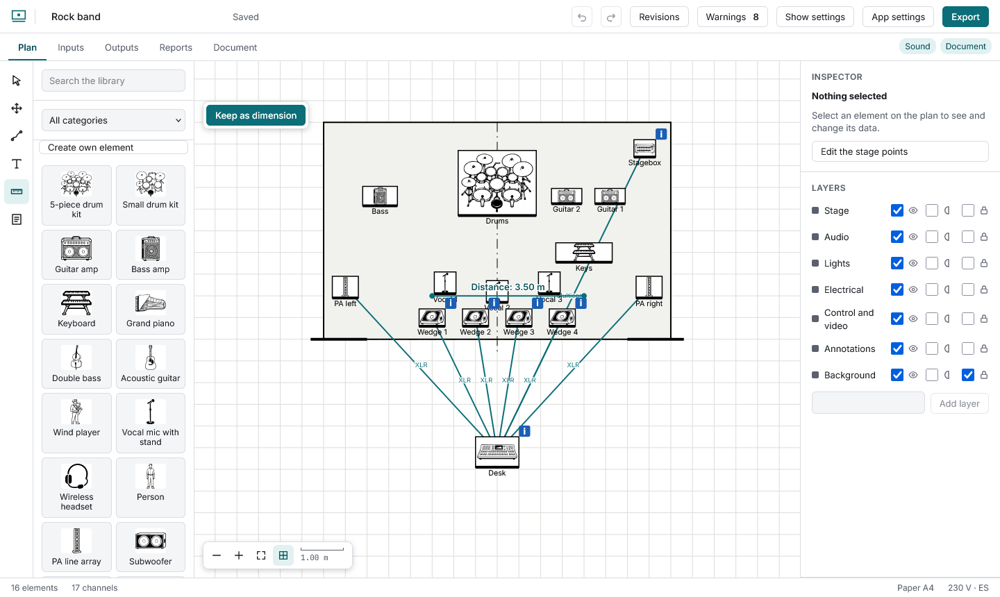
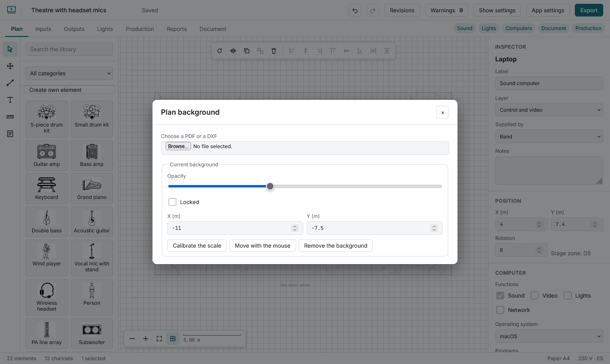

# The stage plot

Search the library (accents ignored) and click an element: it appears in the first free spot, selected. Drag it into place; it snaps to the grid (**Alt** while dragging turns snapping off). The inspector holds the label, who supplies it (band, venue, rental), notes, position and rotation.

**Shift**+click adds or removes; dragging on the background draws a selection box; **Ctrl+A** selects all. The bar on top rotates, flips, duplicates, groups, deletes, aligns (two or more) and distributes (three or more). A group moves as one. **Layers** can be hidden, dimmed and locked.

**Measure** gives the distance between two points (metres, or feet in imperial shows). After measuring, **Keep as dimension** leaves it on the plot as a dimension on the Annotations layer: it reads its length, moves like any element, prints on the PDF and can be undone. **Text** drops a note and leaves its label ready to type.

**PDF or DXF background** imports the venue plan (up to 25 MB; a PDF becomes an image in your browser, a DXF is drawn as lines). **Calibrate the scale** by clicking two points a known distance apart and typing that distance; set the opacity and lock it. It is saved inside the show file. **Move with the mouse** lets you drag the background across the plot and then press **Done**; it is one undo step and is not available while the background is locked.

Wheel to zoom, **Space** + drag or the Hand tool to pan, **0** to fit. On a phone: two fingers.

## The stage

In **Show settings → Stage**: width and depth, an optional **proscenium width** (leave it empty for none; the proscenium line is drawn as two walls with the opening between them), and the **reference lines** to show (centre line, plaster line, proscenium opening). **Stage deck height** is the height of the stage above the hall floor (it matters for the side section). Raised areas inside the stage are **Riser** and **Platform** elements from the library, each with its own height in the inspector. For an odd-shaped stage tick **Free-form stage** and type the points, one per line as `x; y` in metres (at least three). A free-form stage has no reference lines.

## Your own layers

Below the layer list, type a name and press **Add layer** to make a layer of your own (up to 20). It can be renamed, moved up or down (higher layers are drawn over lower ones) and removed; removing it sends its elements back to the layer of their kind. To put an element on a layer, pick it in the inspector's **Layer** field.

## Your own elements

**Create own element** (top of the library) takes an SVG drawing up to 200 KB and asks for a name, the real size, height, weight, power and layer. The drawing is rebuilt from shapes, paths, groups and flat colours only: text, images, gradients, links, styles and scripts are left out (the dialog says how many), and strokes are redrawn 1.5 px wide. The element lives in the show and travels in the `.scaena` file; it appears first in library searches, and it can only be deleted once it is no longer on the plan.
