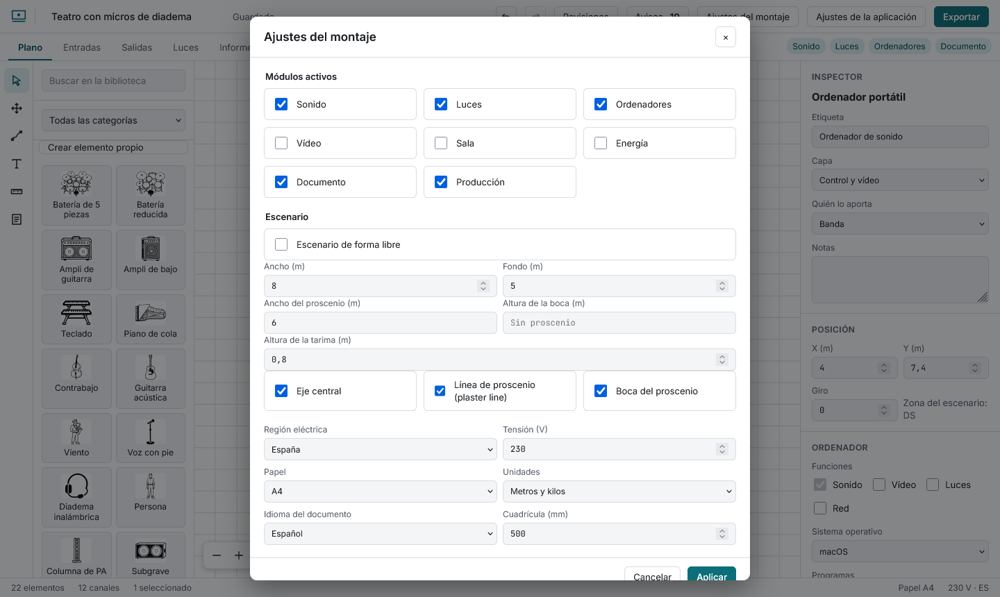
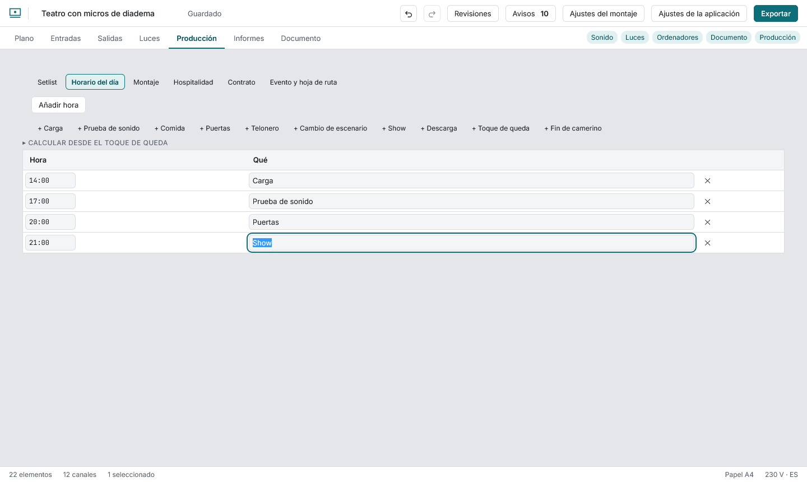
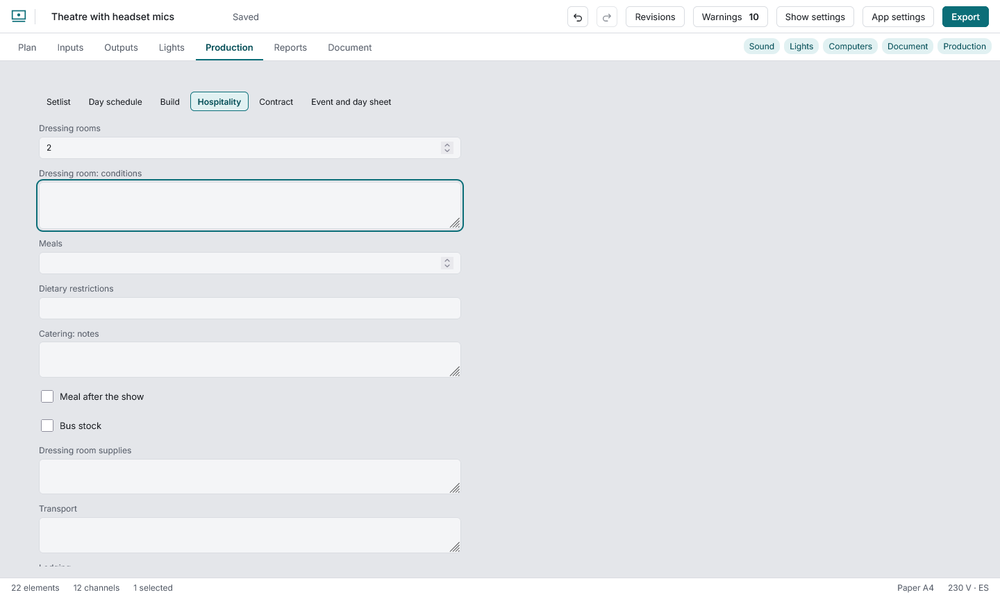

# Production of one event

Turn on the **Production** module. It is for **one event**: for several dates, duplicate the show and change the date.

**Day schedule and Build:** the **+ Load-in, + Soundcheck, + Doors…** buttons add a row with the name; you set the time (`8:30` or `20:30`). Rows read in time order; a badly written time is flagged.

**Setlist:** title, comment and length (`4:30`, `4.5` minutes or `270 s`) with the total.

**Hospitality and contract** are structured forms (dressing rooms, catering, dietary needs, after-show meal, bus stock, supplies, transport, lodging, cash in place of supplies; fee, deposit, payment, cancellation, insurance, show length, crew). scaena stores and prints them; it gives no legal advice.

**Event and day sheet:** venue address, parking, notes and **Download the day sheet (PDF)**.
