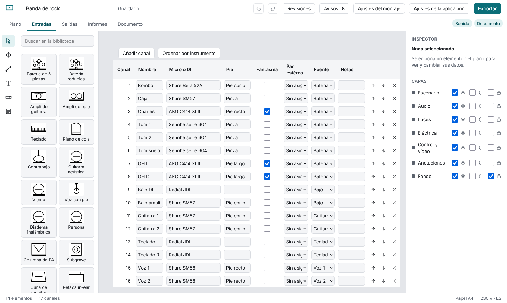
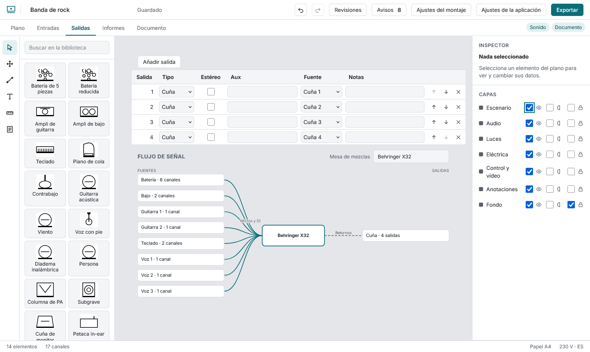

# Sonido: entradas y salidas

## La lista de entradas

Cada fila es un canal. Se edita en la propia tabla; cada cambio se confirma al salir de la celda y se puede deshacer.

- **Micro o DI:** empieza a escribir una marca o un modelo y elige de la lista, o escribe lo que quieras. Al elegir un micro de condensador se marca solo el **48 V** (fantasma); uno dinámico lo quita. Siempre puedes corregirlo.
- **Par estéreo:** elige el canal pareja; el otro queda emparejado a la vez. Empieza el par en un canal impar.
- **Fuente:** el elemento del plano de donde sale. Al pulsar una fila se selecciona ese elemento en el plano.
- Los canales se numeran de 1 a n sin huecos; **subir** y **bajar** intercambian números y **Ordenar por instrumento** agrupa por tipo (batería, guitarras, teclas, voces…).

## Las salidas y el flujo de señal

Cuñas, in-ear, principal y envíos, con su aux y el elemento que las lleva. Debajo, el **flujo de señal**: las fuentes agrupadas por elemento, la mesa (escribe su modelo) y las salidas. Cada línea lleva su nombre escrito y un trazo distinto: el color nunca va solo.

## Cosas que avisan

Canales sin nombre o sin micro, pares mal empezados, cuñas dibujadas que nadie pide (o al revés), monitores desordenados. Ver [Los avisos](avisos.md).
