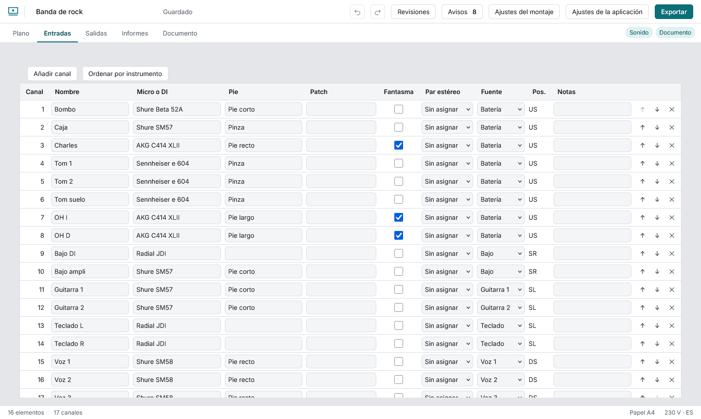
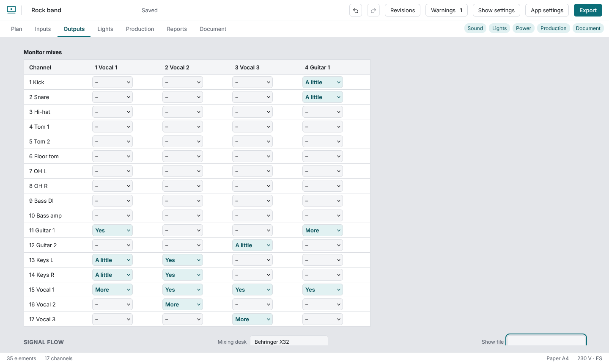

# Sound

Each row is a channel, edited in the table (each change is one undo step). Type a brand or model in **Mic or DI** and pick from the list, or type anything; picking a condenser ticks **48 V**, a dynamic clears it, and you can always override. **Patch** is where the channel plugs in (stagebox and port, for example “SB A 12”). You can type it, or let the cables give it: in the inspector of an audio cable set **Input it arrives at** and **Lines** (a drum loom is one cable with 8 lines), and the channels of the element it comes from take those ports in channel order, shown in grey in the cell. A DI box in the path passes on the channels of what feeds it. What you type wins, and a warning tells you if it differs from the cables. The same patch on two channels warns; two cables on one port is an error. **Pos.** shows where the source sits on the stage (US upstage, DS downstage, C centre, SL stage left, SR stage right, and combinations such as USC or DSL), read from the plan; the PDF adds a legend under the table. Choose a **stereo pair** (the other channel is paired too; start pairs on an odd channel). **Source** is the plot element the channel comes from, and clicking a row selects it on the plot. Channels stay numbered 1 to n; up and down swap numbers, **Sort by instrument** groups them by kind.

**Number wedges** renumbers the wedges drawn on the plan left to right and front to back, using the numbers they already hold; other outputs keep theirs. Wedges, in-ears, main and sends, with their aux and the element that carries them. Below, the **signal flow**: sources grouped by element, the desk (type its model) and the outputs. Every line has a written label and its own stroke pattern, so colour is never the only cue.

**Racks:** add a **Rack** from the library and press **Build the rack** in its panel: set its units (U), add devices with their height, and move them up and down. It warns when the gear does not fit ("too much gear"), and the rack appears in the reports and as a section of the document.
