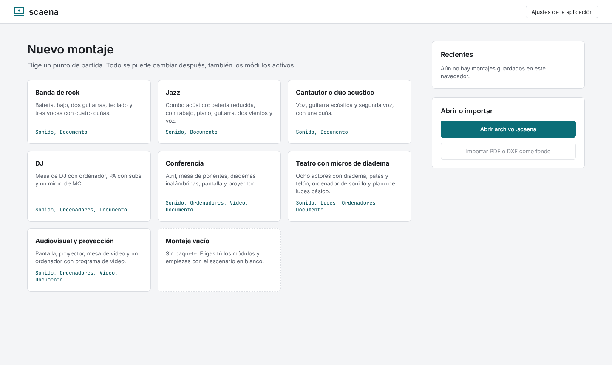
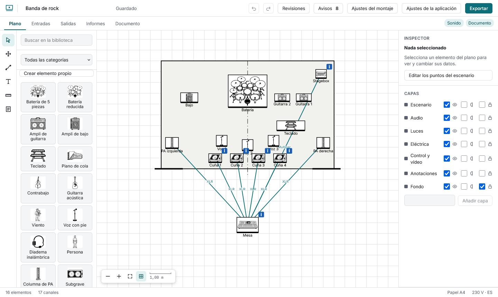

# Getting started

Pick the package closest to your show (rock band, jazz, singer-songwriter, DJ, conference, theatre with headset mics, AV) or an empty show. **Full showcase** uses every feature of the app, with a venue plan, a logo and two saved revisions: it is the one for trying things out. Its cable lines start hidden so the plot can be read; the button under the plot shows them. Each comes with the plot laid out and a suggested channel list; the theatre one also has a basic light plot. Everything can be changed.

Left: the element **library**. Centre: the **plot**, with the **views** above it (Plot, Inputs, Outputs, Lights, Production, Reports, Document; only what your modules need). Right: the **inspector** and the **layers**.

**Show settings** turns modules on (Sound, Lights, Computers, Video, Room, Electrical, Document, Production), sets the stage size, the electrical region, the paper (A4, A3, Letter, Tabloid) and the language of the document, which can differ from the interface's.

The start screen lists your saved shows (each can be duplicated or deleted, with a confirmation), opens `.scaena` files, and keeps **My templates**: use **Export → Save as my own template** to add one. Your work is saved automatically; see [Your data](data.md).
