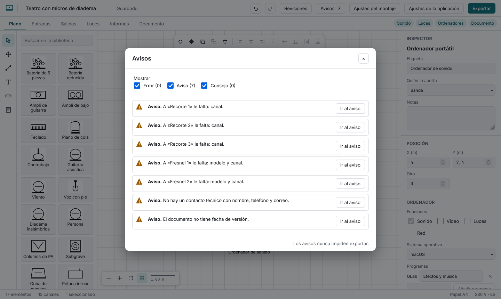

# Warnings

The **Warnings** button shows how many there are. Each says in words what is wrong and has **Go to the warning**. **Warnings never stop you from exporting.**

Three severities, each with its own shape as well as colour (circle, triangle, square): **error** (the document would be wrong: a row pointing at something that no longer exists, two instruments on the same DMX address, a dimmer or phase over its limit, a bar over its load), **warning** (probably wrong: channels with no name or mic, a stereo pair starting on an even channel, a wedge asked for but not drawn, an instrument missing data, an unmarked outlet, repeated units, a badly written time, a program that does not exist for the computer's system, no contact or date) and **tip** (an improvement: gaps in numbering, unordered monitors, no “supplied by”).

Warnings also show as a small mark on the table row and a badge on the plot element; filter them by severity in the panel.
